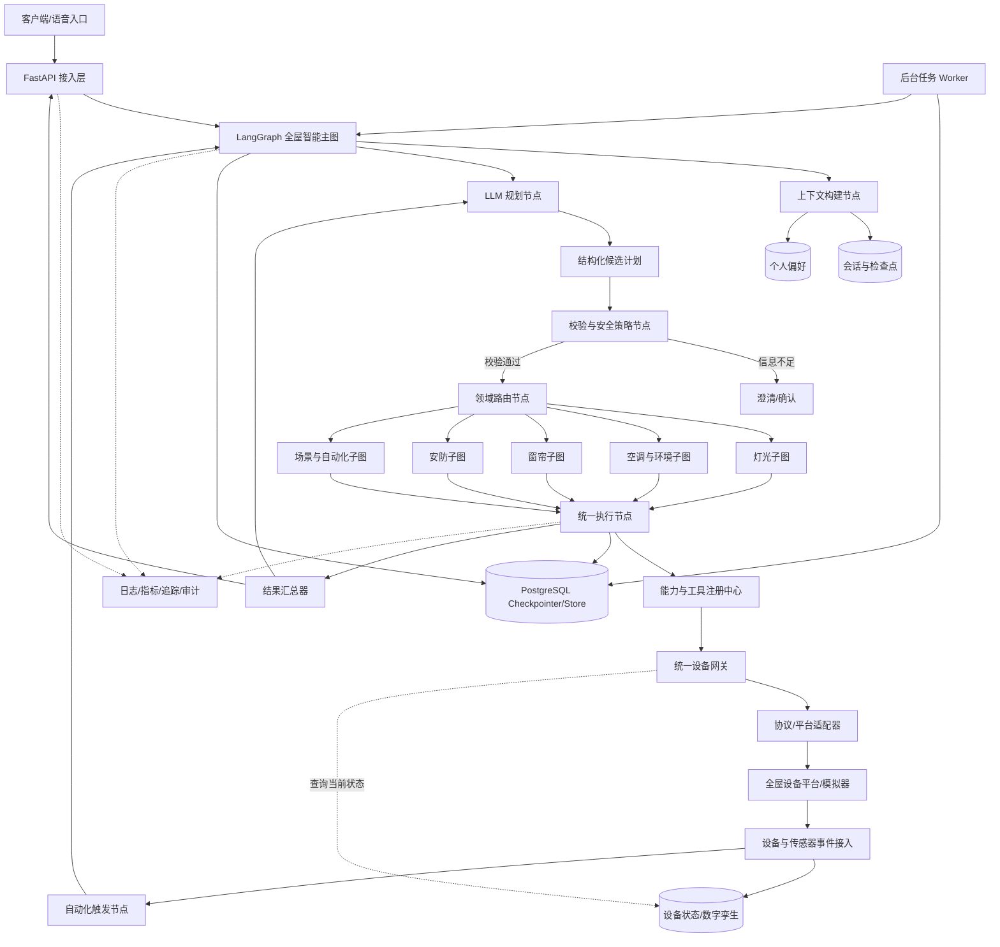
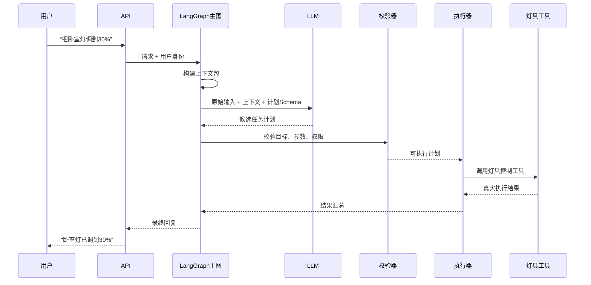
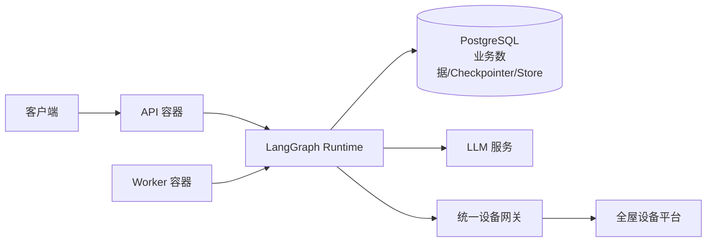

# 全屋智能 Agent 技术架构设计（灯具控制为首个领域）

> 文档类型：全屋智能平台技术架构设计稿
> 更新日期：2026-10-17
> 关联文档：[灯具控制与多指令 Agent 功能设计](./灯具控制与多指令Agent架构设计.md)

## 1. 文档目标

本文说明全屋智能 Agent 项目如何从零落地，并以灯具控制作为首个业务领域，包括：

- 系统采用什么总体架构；
- LLM、业务程序、工具和设备平台如何协作；
- 多指令如何规划、校验和执行；
- 会话记忆与个人偏好如何保存和使用；
- 项目如何组织代码、数据、接口、任务和测试；
- 首版如何部署，以及后续在什么条件下扩展。

灯具控制是首个落地领域，不是产品的最终边界。长期产品应能够接入空调、窗帘、安防、环境传感器、家电、能源管理和跨设备场景，而不重写主编排流程。

本文不重复定义当前灯具功能，首个领域范围以关联的功能设计文档为准。

## 2. 核心架构决策

### 2.1 总体形态

项目从第一版开始采用：

> **LangGraph 全屋智能主图 + 领域子图 + 统一能力与工具平台 + 设备适配层**

具体含义：

- 首版仍然使用模块化单体部署，避免过早拆微服务；
- LangGraph 作为 Agent 的核心编排运行时，而不是后期再替换自定义状态机；
- 一个全屋智能主图负责上下文、规划、路由、确认、执行和回复；
- 灯光、空调、窗帘、安防、环境传感器等领域以独立子图和领域模块接入；
- API 服务和后台任务 Worker 使用同一套图、领域与工具模块；
- LLM 负责理解自然语言并生成结构化候选计划；
- LangGraph 中的确定性节点负责校验、权限、确认、任务依赖和真实执行；
- 所有外部设备操作必须经过受控工具；
- PostgreSQL 保存业务数据，并作为生产环境的图检查点与长期记忆存储；
- 先以灯光领域验证平台，但接口、状态和工具不能写死为灯具专用；
- 领域子图不等同于多个自由自治 Agent，只有出现独立复杂推理需求时才升级为专业 Agent。

### 2.2 为什么选择这种架构

| 目标 | 设计选择 |
|---|---|
| 理解灵活的自然语言 | 使用 LLM 统一识别意图、参数和多指令关系 |
| 防止模型直接控制设备 | LLM 只产生候选计划，程序校验后才调用工具 |
| 支持顺序、并行和条件任务 | 使用 LangGraph 显式状态、节点和条件边 |
| 支持长流程暂停与恢复 | 使用检查点、线程状态和 `interrupt` |
| 支持连续对话 | 统一构建上下文包并保存线程检查点 |
| 支持个人偏好 | 使用跨线程长期存储，并由用户显式管理 |
| 接入新的全屋领域 | 通过领域子图、能力模型和工具插件扩展 |
| 支持不同团队并行开发 | 主图只依赖子图的输入输出契约 |
| 降低首版复杂度 | 单仓库、单数据库，不引入消息队列和微服务 |
| 保留后续服务化能力 | 图、领域、工具和设备适配器均使用稳定契约隔离 |

### 2.3 首版明确不采用的方案

- 不采用多个 Agent 自由讨论后决定设备操作，但允许使用可审计的领域子图；
- 不采用开放式 ReAct 循环反复尝试工具；
- 不用正则表达式先解析自然语言意图；
- 不把设备实时状态放进长期记忆；
- 不为了未来规模提前拆微服务；
- 不引入向量数据库保存少量结构化个人偏好；
- 不在首版同时接入多种设备协议；
- 不把 LangGraph State 当成业务数据库，设备、用户、偏好和审计仍有明确的数据模型。

## 3. 技术选型

### 3.1 推荐技术栈

| 层次 | 推荐方案 | 用途 |
|---|---|---|
| 开发语言 | Python | Agent、业务编排和设备工具开发 |
| Web API | FastAPI | 对话、偏好、任务查询及管理接口 |
| Agent 编排 | LangGraph | 主图、领域子图、状态持久化、暂停恢复和人工确认 |
| 数据模型 | Pydantic | LLM 输出、API 参数和工具参数校验 |
| 数据访问 | SQLAlchemy + Alembic | 数据库访问和结构迁移 |
| 数据库 | PostgreSQL | 业务数据、图检查点、偏好、任务、审计和结构化计划 |
| LLM 接入 | 模型供应商 SDK | 结构化输出、文本生成和模型调用 |
| 后台任务 | 独立 Worker + PostgreSQL 任务表 | 延迟任务、定时任务和失败恢复 |
| 测试 | pytest | 单元、集成、契约和端到端测试 |
| 可观测性 | 结构化日志 + OpenTelemetry | 请求追踪、耗时和错误定位 |
| 部署 | Docker Compose | 本地、测试和首版单机部署 |

所有依赖在项目启动时固定具体版本，并通过自动化测试后再升级，不在设计文档中锁死未来版本号。

### 3.2 为什么从首版使用 LangGraph

如果产品只做灯具控制，自定义状态机可以满足首版。但产品目标是全屋智能接入，长期会出现跨领域指令、条件自动化、用户确认、设备等待、任务恢复和不同领域团队协作。后期从自定义状态机迁移到图运行时，会同时影响状态结构、执行记录、确认流程和测试体系。

因此从首版使用 LangGraph，重点利用以下能力：

- **显式状态图**：把 LLM 节点与确定性业务节点放在同一条可追踪流程中；
- **持久化检查点**：支持会话连续性、失败恢复和长流程恢复；
- **Interrupt**：在批量控制、安防或高风险操作前暂停并等待用户确认；
- **子图**：把灯光、空调、窗帘、安防等领域隔离，同时保留统一入口；
- **流式事件**：向客户端展示规划、确认和执行进度；
- **短期与长期状态分离**：线程状态保存当前流程，长期存储保存个人偏好。

使用 LangGraph 不等于所有逻辑都由 Agent 决定。设备权限、参数校验、工具调用和状态核验仍然是确定性节点。

### 3.3 为什么首版不使用 Redis

首版可以直接使用 PostgreSQL 保存会话、任务和幂等记录。只有出现以下情况时再增加 Redis：

- 多实例部署后需要分布式锁；
- 会话读取量导致数据库压力明显升高；
- 需要高频发布订阅或短期缓存；
- 实测表明 Redis 能解决已出现的性能问题。

## 4. 总体系统架构



### 4.1 产品级逻辑分层

| 层次 | 责任 | 扩展方式 |
|---|---|---|
| 交互层 | App、语音、面板和第三方入口 | 新增渠道适配器 |
| Agent 编排层 | 理解、规划、路由、确认、恢复和回复 | 扩展主图节点或条件边 |
| 领域层 | 灯光、空调、窗帘、安防、能源和场景规则 | 新增领域子图与领域包 |
| 能力与工具层 | 将领域动作映射为受控工具 | 注册新的能力和工具 |
| 设备接入层 | Matter、MQTT、Home Assistant、厂商云等 | 新增协议或平台适配器 |
| 数据与状态层 | 图检查点、会话、偏好、设备目录、任务和审计 | 扩展数据模型，不改变上层语义 |

### 4.2 主图与领域子图边界

主图只处理所有领域都共有的步骤：

```text
接收请求
  → 构建上下文
  → 识别与规划
  → 全局校验
  → 领域路由
  → 领域子图
  → 全局执行协调
  → 结果汇总
  → 回复
```

领域子图负责领域特有的语义和规则。例如：

- 灯光子图理解亮度、色温、颜色和场景；
- 空调子图理解模式、目标温度、风速和联动约束；
- 窗帘子图理解开合比例和防夹状态；
- 安防子图处理布防、撤防和更严格的确认策略；
- 场景子图协调跨领域动作，例如“离家模式”。

主图不能直接包含所有设备细节，否则每增加一个领域都要修改核心流程。领域子图通过稳定的输入输出 Schema 与主图交互。

### 4.3 请求驱动与事件驱动并存

全屋智能存在两类入口：

- **请求驱动**：用户通过文字、语音或 App 发起控制、查询和场景指令；
- **事件驱动**：门磁、人体传感器、温湿度传感器和设备状态主动上报事件。

设备网关将不同协议事件转换为统一事件，再完成：

1. 更新带时间戳、来源和质量标记的设备状态；
2. 根据事件 ID 去重，避免重复触发；
3. 匹配用户已经启用的自动化规则；
4. 需要 Agent 推理时，以系统事件身份启动主图；
5. 涉及高风险动作时进入确认或安全策略节点。

设备状态属于实时业务状态，不属于 Agent 长期记忆。自动化规则也不能让 LLM 临时自由生成并直接执行，必须由用户创建、启用，并经过确定性条件检查。

### 4.4 星火交互终端

终端采用轻量客户端形态，不承载大模型、长期记忆或设备协议。它的产品定位是：

> 一个以星火形象为核心、以语音交互为主、以聊天记录和任务状态为辅助的轻量智能终端。

终端分为两个阶段：当前使用电脑浏览器和耳机作为验证终端，后续再接入 ESP32、带屏设备或定制硬件。两者都通过统一的交互协议连接云端，硬件替换不改变主图、领域子图、记忆和设备网关。

终端与云端的职责边界如下：

| 部分 | 主要职责 |
|---|---|
| 终端 | 麦克风采集、扬声器播放、显示渲染、触摸与按键、静音、音量和断线重连 |
| 交互接入层 | 音频流、文本请求、会话鉴权、流式响应和终端事件推送 |
| LangGraph 主图 | 对话理解、任务规划、记忆、确认、工具调用和结果汇总 |
| 设备网关 | 设备发现、能力映射、命令执行、状态查询和事件标准化 |

终端只接收结构化交互状态，不由 LLM 直接生成页面。推荐的终端状态包括：

```text
idle                  空闲
listening             正在聆听
thinking              正在思考
speaking              正在播报
executing             正在执行设备任务
confirmation_required 等待用户确认
completed             执行完成
error                 执行失败
```

终端根据状态在两种模式之间渲染：

```text
默认或无操作 → 星火模式
语音交互     → 星火动画 + 当前状态
复杂任务     → 星火动画 + 任务进度
用户主动查看 → 聊天记录模式
确认或失败   → 聊天记录模式或明确提示
```

显示屏可以通过触摸、滑动或语音命令切换模式。聊天记录默认以当前会话为范围，并由隐私设置决定是否保存更长时间的内容。终端不保存设备凭据，也不直接调用底层设备适配器。

当前验证形态如下：

```text
电脑浏览器
  ├── 文字输入
  ├── 麦克风语音输入
  ├── 耳机语音输出
  ├── 星火模式网页动画
  └── 聊天记录与任务进度页面
```

专用硬件终端只属于后续客户端实现，不作为当前 Agent、工具或真实设备适配器的开发前置条件。

## 5. 核心请求流程

### 5.1 普通灯具控制



### 5.2 多指令请求

用户输入：

> “打开客厅灯，同时关闭书房灯，然后把卧室灯调到 30%。”

处理过程：

1. LLM 一次性生成完整候选计划，而不是边执行边猜测下一步；
2. 校验器解析真实设备，并检查所有节点；
3. 执行器识别客厅和书房节点可并行；
4. 卧室节点按用户表达的依赖关系等待；
5. 每个节点分别记录成功、失败或跳过；
6. 结果汇总器生成全部成功或部分成功回复。

### 5.3 保存个人偏好

用户输入：

> “记住，以后卧室灯默认调到 30%。”

处理过程：

1. LLM 识别为“设置偏好”，而不是立即控制灯具；
2. 校验器检查偏好类型、作用范围和用户身份；
3. 偏好工具保存 `卧室 + 默认亮度 + 30%`；
4. 系统返回已保存内容，并提供查看或删除方式；
5. 后续用户说“打开卧室灯”且未指定亮度时，才使用该偏好补全参数；
6. 如果用户明确指定 70%，当前指令覆盖 30% 的历史偏好。

### 5.4 延迟任务

用户输入：

> “十分钟后关闭床头灯。”

处理过程：

1. LLM 生成延迟任务候选计划；
2. 程序把相对时间转换为带时区的绝对执行时间；
3. 任务工具将任务写入 PostgreSQL；
4. Worker 到期领取任务并再次检查设备与用户权限；
5. Worker 调用灯具工具并记录结果；
6. 用户可以通过任务编号查询或取消。

### 5.5 设备事件与自动化

示例：用户已经启用“检测到有人进入走廊且环境较暗时开灯”。

处理过程：

1. 人体传感器和光照传感器通过设备网关上报标准事件；
2. 事件接入模块去重并更新设备状态；
3. 自动化规则引擎用确定性条件判断人员、光照和时间范围；
4. 规则满足后，以系统事件启动主图或直接进入已批准的场景子图；
5. 子图调用灯光工具并记录本次自动化来源；
6. 如果动作超出用户事先批准的范围，暂停并请求确认。

简单自动化不必每次调用 LLM。只有事件语义复杂、需要自然语言解释或跨领域动态规划时才进入 LLM 节点。

## 6. 模块职责

### 6.1 API 接入层

职责：

- 接收文本请求；
- 验证登录身份和家庭范围；
- 创建 `request_id`、`session_id` 和 `trace_id`；
- 返回普通响应或流式响应；
- 提供偏好和定时任务管理接口。

不负责：

- 直接调用 LLM；
- 理解用户意图；
- 直接访问设备协议。

### 6.2 LangGraph 全屋智能主图

全屋智能主图是一次用户请求的总协调者，也是所有领域共享的稳定骨架。

职责：

- 获取上下文包；
- 调用 LLM 生成候选计划；
- 调用全局校验与安全策略节点；
- 根据任务领域路由到一个或多个领域子图；
- 根据结果进入澄清、确认、执行或闲聊路径；
- 将执行事实交给结果汇总器；
- 通过 Checkpointer 保存节点状态，使流程可以暂停、恢复和追踪。

主图不包含灯光、空调或安防的具体业务细节，也不直接访问设备协议。

### 6.3 领域路由与子图

领域路由节点根据候选任务中的 `domain` 将任务交给对应子图：

```text
lighting     → 灯光子图
climate      → 空调与环境子图
curtain      → 窗帘子图
security     → 安防子图
energy       → 能源子图
scene        → 跨领域场景子图
conversation → 闲聊节点
```

每个领域子图必须提供统一契约：

- 输入：用户、家庭、领域任务、相关设备能力和已解析偏好；
- 输出：规范化任务节点、确认要求、工具调用意图和领域结果；
- 私有状态：仅在该领域内部使用，不直接污染主图状态；
- 公共状态：通过定义好的字段回写主图。

新增领域时，优先新增领域包、子图和工具，不修改已有领域内部实现。只有跨领域公共流程变化时才修改主图。

### 6.4 上下文构建器

上下文构建器生成统一的 `ContextPackage`，避免不同模块各自拼接历史消息。

`ContextPackage` 是传给模型的有限上下文，不等于完整 LangGraph State。主图状态保存流程恢复所需的原始数据，再由上下文构建节点按需生成 `ContextPackage`。

```text
WholeHomeAgentState
├── identity_context      # 用户、家庭、角色和时区
├── current_input         # 当前输入
├── conversation_state    # 当前线程消息与最近目标
├── candidate_plan        # LLM 候选计划
├── validated_plan        # 已校验计划
├── domain_tasks          # 按领域分组的任务
├── approval_state        # 待确认内容与确认结果
├── execution_results     # 各领域与工具执行事实
├── errors                # 可恢复和不可恢复错误
└── response              # 最终回复
```

State 只保存节点间需要共享或恢复的原始数据，不保存拼接完成的提示词，也不复制可以从数据库重新得到的大型对象。

```text
ContextPackage
├── request_context       # 用户、家庭、会话、时区
├── current_input         # 当前原始输入
├── recent_turns          # 最近完整问答
├── pending_action        # 待澄清或待确认计划
├── relevant_preferences  # 与当前设备/房间相关的偏好
├── recent_targets        # 最近操作对象，用于代词解析
└── device_catalog        # 可见设备及能力摘要
```

规则：

- 使用统一字符或 Token 预算，建议从 6000 字符开始配置；
- 最近问答按完整轮次加入，不能截断半个问答；
- 只加载与当前家庭和用户有关的偏好；
- 不把全部历史设备状态放入上下文；
- 待确认计划优先级高于普通历史对话；
- 用户关闭偏好功能时，不加载长期个人偏好。

### 6.5 LLM 网关

所有模型调用只能经过 LLM 网关。

职责：

- 统一模型、提示模板和结构化输出配置；
- 设置超时、有限重试和并发上限；
- 记录模型、提示模板和 Schema 版本；
- 区分规划调用与回复生成调用；
- 处理拒绝、超时、截断和无效结构化输出。

并发容量只在真正调用模型时获取和释放。API、主图、子图、业务服务和任务节点不得重复占用同一份模型调用容量。

### 6.6 计划与策略校验器

校验器是 LLM 与真实操作之间的强制边界。

依次检查：

1. 输出结构是否符合 Schema；
2. 领域、任务类型和能力是否已经注册；
3. 家庭空间、房间和设备是否真实存在；
4. 用户是否有权操作；
5. 设备是否支持目标能力；
6. 参数是否在合法范围；
7. 多个任务是否冲突或形成循环依赖；
8. 是否需要澄清或用户确认；
9. 延迟时间和时区是否有效；
10. 偏好写入是否得到明确授权。

校验失败时不调用任何具有副作用的工具。

### 6.7 任务执行器

执行器由 LangGraph 中的确定性节点组成，只接收已经校验的计划。LangGraph 负责流程状态和恢复，执行器负责业务节点依赖、工具调用和结果记录。

节点状态：

```text
PENDING → READY → RUNNING → SUCCEEDED
                          ↘ FAILED
                          ↘ TIMED_OUT
                          ↘ CANCELLED
                          ↘ SKIPPED
```

执行规则：

- 没有依赖且设备不冲突的节点可以并行；
- 操作同一设备的节点默认串行；
- 前置节点失败时，依赖它的节点按计划标记为跳过；
- 无关分支继续执行；
- 每个有副作用的节点必须携带幂等键；
- 只有临时网络错误允许有限重试；
- 执行器不重新解释用户原始语言。

### 6.8 能力与工具注册中心

注册中心维护“领域能力 → 标准动作 → 工具”的映射。首版实现灯光和公共工具，但注册结构必须允许后续领域以插件方式加入。

| 工具 | 用途 | 是否有副作用 |
|---|---|---|
| `light.resolve` | 将房间名或灯名解析为真实设备 | 否 |
| `light.get_state` | 查询实时开关、亮度和在线状态 | 否 |
| `light.set_state` | 设置开关、亮度、色温或颜色 | 是 |
| `climate.get_state` | 查询温度、模式和风速 | 否 |
| `climate.set_state` | 设置空调模式、温度和风速 | 是 |
| `curtain.set_position` | 设置窗帘开合比例 | 是 |
| `security.arm` | 设置安防模式 | 是，必须确认 |
| `scene.activate` | 执行跨领域场景 | 是 |
| `task.create` | 创建延迟或定时任务 | 是 |
| `task.get` | 查询任务状态 | 否 |
| `task.cancel` | 取消未执行任务 | 是 |
| `preference.list` | 查看个人偏好 | 否 |
| `preference.set` | 新增或修改明确偏好 | 是 |
| `preference.delete` | 删除偏好 | 是 |

每个工具都必须声明：

- 输入和输出类型；
- 调用权限；
- 是否有副作用；
- 超时时间；
- 是否允许重试；
- 幂等规则；
- 可返回的业务错误码。

工具是否在当前部署中可用，由已安装的领域插件和设备能力目录决定。尚未接入空调时，即使 LLM 生成 `climate.set_state`，校验器也必须返回能力不可用，而不是尝试执行。

### 6.9 领域与统一能力模型

所有设备使用统一的设备与能力模型：

- 家庭、空间、房间、设备、设备组和场景；
- 设备所属领域与设备类型；
- 标准能力名称、数据类型、范围、单位和读写属性；
- 设备在线状态；
- 设备别名、权限和可见范围；
- 厂商能力到标准能力的映射。

例如，灯具的亮度、空调的目标温度和窗帘的开合比例都属于不同的标准能力。上层领域子图只使用标准能力，不直接处理厂商字段。

### 6.10 设备网关与适配器

设备网关负责设备发现、能力同步、命令路由、事件标准化和状态更新；适配器把标准命令转换为具体协议或平台命令，并把厂商事件转换为统一事件。

```text
DeviceAdapter
├── list_devices(home_id)
├── get_capabilities(device_id)
├── get_state(device_id)
├── set_state(device_id, desired_state, idempotency_key)
└── subscribe_events(callback)
```

### 6.10.1 Mock 设备适配器要求

当前没有真实设备时，`MockDeviceAdapter` 作为默认实现，必须模拟可观察的设备行为，而不是固定返回成功。至少包括：

- 模拟设备目录、房间、别名和能力；
- 模拟开关、亮度、色温和颜色状态；
- 执行命令后更新状态并返回回执；
- 主动产生设备状态事件；
- 模拟离线、超时、拒绝和部分成功；
- 使用幂等键处理重复请求；
- 支持测试脚本重置或预置设备状态。

Mock 与未来真实适配器必须遵守同一套 `DeviceAdapter` 契约。Agent 和领域子图只能依赖统一能力与工具，不能依赖 Mock 的内部字段。

首版实施顺序：

1. 实现 `MockDeviceAdapter`，用于开发和自动化测试；
2. 根据真实家庭设备环境选择一种协议或平台；
3. 只实现一个真实适配器；
4. 通过相同的适配器契约测试；
5. 后续设备领域继续复用该平台；确有需要时再增加第二种协议适配器。

### 6.11 硬件接入适配是什么意思

如果 Agent 只连接模拟器，不需要真实硬件适配；如果 Agent 要控制真实灯具，就必须实现至少一个真实设备接入方案。

这里的“适配”不是简单地发一个开关请求，而是把外部硬件生态转换成平台内部统一能力，包括：

- 设备发现和注册；
- 房间、设备和别名同步；
- 能力同步，例如是否支持亮度、色温或颜色；
- 统一控制命令；
- 实时状态读取和事件订阅；
- 在线/离线状态；
- 认证、权限和凭据管理；
- 厂商错误码到平台错误码的转换；
- 超时、幂等和重复事件处理。

### 6.12 四种接入方式的区别

这四种方式是不同的硬件接入路线，不是必须同时使用的四个组件：

| 接入方式 | Agent 实际连接对象 | 适合情况 | 主要工作 |
|---|---|---|---|
| Matter | Matter Controller 或桥接器 | 希望采用标准化、跨厂商的智能家居设备 | 设备配网、Fabric 管理、能力映射、状态订阅 |
| MQTT | MQTT Broker 和设备 Topic | 设备或网关支持自定义消息协议 | 约定 Topic、消息格式、QoS、状态保留和命令回执 |
| Home Assistant | Home Assistant API/WebSocket | 已经使用 Home Assistant 管理多种设备 | 同步实体和能力，调用 HA 服务，订阅状态事件 |
| 厂商云 | 厂商 REST API、SDK 或 Webhook | 设备只能通过厂商云控制 | OAuth/密钥、限流、云端状态、错误和厂商版本兼容 |

### 6.13 推荐的接入策略

不要让主图或 LLM 直接知道 Matter、MQTT 或厂商 API。统一链路应当是：

```text
LangGraph 领域子图
  → 标准设备能力与工具
  → DeviceGateway
  → 具体适配器
  → 真实硬件或设备平台
  → 标准状态事件
  → DeviceGateway / 状态存储 / 自动化触发
```

建议实施顺序：

1. 先实现 `MockDeviceAdapter`，不依赖真实硬件完成主图、工具和测试；
2. 根据目标用户已有的硬件生态选择一种真实接入路线；
3. 实现该路线的发现、能力、命令和状态闭环；
4. 用同一套适配器契约测试 Mock 和真实实现；
5. 以后增加第二种路线时，只增加新的适配器，不修改主图和灯光领域语义。

如果目标是快速兼容用户已有的多品牌设备，通常优先评估 Home Assistant；如果目标是建设面向多厂商的新硬件生态，则优先评估 Matter；如果是自研设备或已有网关，MQTT 往往更直接；只能使用厂商云的设备则实现厂商云适配器。

## 7. LLM 规划设计

### 7.1 主图采用单次结构化规划

一次用户请求首先由主图调用一次规划模型，要求输出固定结构。规划阶段识别任务所属领域并形成跨领域候选计划，但不调用真实设备，也不执行副作用工具。

推荐输出结构：

```json
{
  "intent": "device_command",
  "needs_clarification": false,
  "clarification_question": null,
  "tasks": [
    {
      "task_id": "t1",
      "domain": "lighting",
      "type": "light.set_state",
      "target": {
        "room_name": "卧室",
        "device_name": null
      },
      "arguments": {
        "brightness_pct": 30
      },
      "depends_on": [],
      "condition": null
    }
  ],
  "preference_change": null
}
```

该结构是候选计划，不能直接执行。主图按 `domain` 将任务发送给对应领域子图；领域子图补充领域规则并返回规范化任务。

### 7.2 为什么不用开放式工具循环

开放式循环让模型在每一步结果后自行决定下一个工具，适合探索型任务，但不适合首版灯具控制：

- 多指令的完整范围不容易在执行前审核；
- 更难保证同一设备的冲突顺序；
- 模型可能产生不必要的重复调用；
- 用户确认的计划可能与实际调用序列不一致；
- 测试和审计成本更高。

因此首版采用“主图先形成完整跨领域计划，再由领域子图和确定性节点执行”。只有确实需要根据外部未知结果重新推理时，才通过图中的显式条件边进入受限的第二次规划节点。

### 7.3 模型调用分类

| 调用类型 | 输入 | 输出 | 是否可调用工具 |
|---|---|---|---|
| 计划调用 | 用户输入 + ContextPackage | 结构化候选计划 | 否 |
| 领域规划 | 领域任务 + 领域能力 | 规范化领域任务 | 否 |
| 澄清回复 | 缺失项和候选对象 | 一条明确问题 | 否 |
| 闲聊调用 | 用户输入 + 有限历史 | 普通文本 | 否 |
| 结果表达 | 已执行事实 + 用户输入 | 自然语言回复 | 否 |

真实工具调用始终发生在应用程序中，不发生在模型服务内部。

### 7.4 提示模板职责

规划提示模板必须明确：

- 只输出 Schema 允许的字段；
- 不虚构设备 ID；
- 不假设设备在线或操作成功；
- 区分一次操作与保存偏好；
- 识别顺序、并行、条件和延迟；
- 信息不足时标记澄清，而不是猜测；
- 不输出任何设备凭据或底层协议命令。

### 7.5 Structured Output 与原生 Function Calling 的选择

首版优先使用 Structured Output 生成完整 `TaskPlan`，不把 `light.set_state` 等真实副作用工具直接暴露给模型。

如果所选模型 SDK 通过 Function Calling 提供更稳定的严格参数约束，可以只向模型暴露一个无副作用的 `submit_candidate_plan` 函数。它的参数就是完整 `TaskPlan`，函数返回只表示“候选计划已收到”，不代表设备已经执行。

真实灯具工具仍由应用程序在校验后调用。这样可以使用模型平台的结构化能力，同时不改变“模型规划、程序批准、工具执行”的安全边界。

## 8. 工具调用设计

### 8.1 工具调用链

```text
LLM 候选任务
  → Pydantic 结构校验
  → 业务与权限校验
  → 工具名称映射
  → 工具参数构造
  → 执行器调用工具
  → 工具返回规范结果
  → 写入执行记录
  → 生成回复
```

### 8.2 工具结果格式

所有工具返回统一结果：

```json
{
  "ok": true,
  "status": "verified",
  "data": {},
  "error": null,
  "started_at": "2026-10-17T20:00:00+08:00",
  "finished_at": "2026-10-17T20:00:01+08:00"
}
```

控制类工具需要区分：

- `accepted`：平台已接受命令；
- `applied`：设备报告已应用；
- `verified`：回读状态与目标一致。

只有工具返回相应事实后，回复中才能使用“已完成”。

### 8.3 幂等与重复请求

每个副作用节点生成稳定的幂等键：

```text
hash(plan_id + task_id + target_device_id + normalized_arguments)
```

同一幂等键重复到达时，工具返回原执行结果，不再次产生副作用。

## 9. 记忆与个人偏好架构

### 9.1 信息分类

| 类别 | 存储位置 | 生命周期 | 说明 |
|---|---|---|---|
| 图执行状态 | LangGraph Checkpointer | 当前线程和保留周期 | 节点恢复、连续对话和人工确认 |
| 最近对话 | Checkpointer + `messages` | 按会话保留策略 | 图内使用原始消息，业务表用于查询和审计 |
| 待确认计划 | 图状态 + `plans` | 确认、取消或过期 | `interrupt` 恢复时复用同一计划 |
| 最近操作对象 | 图状态 | 当前线程 | 用于“它”“再亮一点” |
| 个人偏好 | LangGraph Store + `preferences` | 用户删除或关闭 | 跨线程读取的显式长期信息 |
| 执行记录 | `executions` | 按审计策略 | 证明真实结果 |
| 设备实时状态 | 不作为记忆保存 | 实时查询 | 以设备工具结果为准 |

Checkpointer 保存“当前流程走到哪里”，Store 保存“跨会话需要记住什么”，业务数据表保存“系统事实和审计证据”。三者用途不同，不能只依赖图检查点代替业务数据库。

### 9.2 个人偏好模型

```text
Preference
├── preference_id
├── user_id
├── home_id
├── scope_type       # user / room / device / scene
├── scope_id
├── preference_key   # default_brightness 等
├── value
├── source           # explicit_chat / settings / confirmed_suggestion
├── enabled
├── created_at
└── updated_at
```

写入条件：

- 用户明确说“记住”“以后默认”；
- 用户在设置页面主动保存；
- 系统提出建议且用户明确确认。

禁止行为：

- 从一次控制操作自动推断长期偏好；
- 根据偏好主动控制设备；
- 不同用户之间共享个人偏好；
- 用户关闭偏好后继续注入模型上下文。

### 9.3 偏好优先级

```text
当前明确指令
  > 当前会话临时要求
  > 已启用的个人偏好
  > 家庭共享场景
  > 系统默认值
```

使用偏好补全参数时，系统应在执行记录中标明参数来源，便于回答“为什么设置成 30%”。

### 9.4 记忆控制

提供以下用户控制：

- 个人偏好总开关；
- 查看已保存偏好；
- 修改单项偏好；
- 删除单项或全部偏好；
- 当前请求不使用个人偏好；
- 当前会话不继续记住上下文。

下层控制只能减少记忆使用范围，不能绕过用户已经关闭的上层开关。

## 10. 数据架构

### 10.1 核心数据表

| 数据表 | 关键内容 |
|---|---|
| `users` | 用户身份、状态和时区 |
| `homes` | 家庭空间 |
| `home_members` | 用户与家庭的角色和权限 |
| `rooms` | 房间信息 |
| `domains` | 已安装领域及其版本和启用状态 |
| `devices` | 设备、所属领域、平台标识和在线摘要 |
| `device_capabilities` | 标准能力、范围、单位、读写属性和厂商映射 |
| `device_states` | 最新状态、观测时间、来源和质量标记 |
| `device_events` | 去重后的设备与传感器事件 |
| `device_aliases` | 用户或家庭定义的设备别名 |
| `sessions` | 会话和会话状态 |
| `messages` | 用户与 Agent 消息 |
| `preferences` | 用户长期偏好及来源 |
| `plans` | 原始候选计划、校验结果和计划哈希 |
| `plan_tasks` | 任务节点、依赖、参数和状态 |
| `scenes` | 跨领域场景定义 |
| `automations` | 条件、触发器、动作和启用状态 |
| `tool_executions` | 工具调用、结果、耗时和幂等键 |
| `scheduled_tasks` | 延迟任务、执行时间和取消状态 |
| `audit_events` | 权限、确认和重要操作审计 |

LangGraph Checkpointer 和 Store 使用独立命名空间或独立 Schema，避免框架内部表与业务表相互耦合。

### 10.2 结构化字段与 JSONB 的边界

以下内容使用普通列：

- 用户、家庭、设备和任务主键；
- 状态、时间、权限和幂等键；
- 经常用于筛选、排序或唯一约束的字段。

以下内容可以使用 JSONB：

- LLM 原始结构化计划；
- 不同设备的能力描述；
- 工具请求和响应快照；
- 不同偏好类型的值。

不能把整个数据库设计成一个无约束 JSON 文档。关键业务状态必须使用可约束、可索引的普通列。

### 10.3 数据一致性

- 计划确认时保存 `plan_hash`；
- 确认后的计划如发生变化，必须重新确认；
- 任务领取使用数据库锁，防止多个 Worker 重复执行；
- 工具执行结果先落库，再生成最终成功回复；
- 偏好更新和审计事件放在同一事务中；
- 删除偏好后立即停止后续上下文注入。

## 11. API 设计

### 11.1 对话接口

```text
POST /v1/chat
```

输入：

- `session_id`；
- `message`；
- `use_preferences`；
- 客户端请求 ID。

输出：

- Agent 回复；
- 请求状态；
- 是否需要澄清或确认；
- 计划和任务摘要；
- 可选的进度事件。

### 11.2 确认接口

```text
POST /v1/plans/{plan_id}/confirm
POST /v1/plans/{plan_id}/cancel
```

确认时必须提交计划版本或哈希，避免确认后执行另一份计划。

技术上，确认节点使用 LangGraph `interrupt` 暂停当前线程并写入检查点。用户确认后，接口以同一个 `thread_id` 和恢复命令继续执行，而不是重新调用 LLM 生成计划。

### 11.3 偏好接口

```text
GET    /v1/preferences
PUT    /v1/preferences/{preference_id}
DELETE /v1/preferences/{preference_id}
DELETE /v1/preferences
PUT    /v1/preferences/settings
```

### 11.4 任务接口

```text
GET    /v1/tasks
GET    /v1/tasks/{task_id}
DELETE /v1/tasks/{task_id}
```

### 11.5 设备接口

设备管理接口只面向已授权的客户端：

```text
GET /v1/domains
GET /v1/devices
GET /v1/devices/{device_id}/state
GET /v1/devices/{device_id}/capabilities
GET /v1/scenes
```

普通客户端不直接调用底层设备适配器。

## 12. 后台任务设计

首版使用 PostgreSQL 任务表和独立 Worker 触发或恢复 LangGraph 运行，不额外引入消息队列。任务表负责“何时运行”，LangGraph Checkpointer 负责“流程运行到哪里”。

Worker 循环：

1. 领取已到执行时间且状态为 `pending` 的任务；
2. 使用数据库行锁避免重复领取；
3. 将状态更新为 `running`；
4. 重新检查任务是否取消、用户是否仍有权限；
5. 以保存的 `thread_id`、计划版本和任务上下文启动或恢复主图；
6. 由主图路由到领域子图并调用工具；
7. 写入成功或失败结果；
8. 对临时错误按次数和退避规则重试；
9. 服务重启后继续领取未完成任务。

当触发任务数量或跨服务投递量明显增长时，可以增加专用消息队列，但 Agent 流程状态和领域编排仍由 LangGraph 管理。

## 13. 安全与隐私

### 13.1 身份与权限

- 所有请求从认证信息获取 `user_id`，不相信 LLM 输出的用户标识；
- 所有设备查询必须限制在当前家庭范围；
- 家庭成员角色决定查询、控制和管理权限；
- Worker 执行延迟任务前重新检查权限；
- 跨家庭设备 ID 即使真实存在也必须拒绝。

### 13.2 LLM 安全边界

- 不向模型提供设备密钥和平台凭据；
- 模型只能输出允许的候选任务类型；
- 设备名、工具返回值和历史消息都按不可信数据处理；
- 模型输出必须经过类型和业务校验；
- 模型超时或拒绝时不执行任何副作用工具；
- 调试日志不记录完整密钥和敏感个人信息。

### 13.3 个人偏好隐私

- 保存前记录来源和用户授权；
- 用户可以导出、修改、删除或关闭偏好；
- 个人偏好按用户隔离；
- 家庭共享场景需要独立权限；
- 删除后不得继续出现在新的上下文包中；
- 对话文本不因为开启偏好功能而默认全部成为长期记忆。

## 14. 可靠性设计

### 14.1 超时和重试

| 操作 | 建议处理 |
|---|---|
| LLM 超时 | 有限重试一次，仍失败则提示稍后再试 |
| 设备查询超时 | 有限重试，结果标记为未知 |
| 设备控制超时 | 使用相同幂等键重试，不能重复生成命令 |
| 权限或参数错误 | 不重试 |
| Worker 异常退出 | 任务租约到期后重新领取 |

具体超时值通过配置设置，并根据真实设备和模型延迟测量后调整。

### 14.2 部分成功

多个独立设备任务不要求全局事务。一个设备失败时：

- 已成功的独立任务保持成功；
- 依赖失败任务的节点标记为跳过；
- 无关节点继续执行；
- 最终回复逐项说明结果；
- 默认不自动回滚已经成功的灯具操作。

### 14.3 降级策略

- LLM 不可用：App 中的固定按钮控制仍可直接走业务校验和工具；
- 偏好服务异常：不使用偏好，要求用户给出明确参数；
- 状态查询失败：返回状态未知，不使用旧记忆替代；
- 回复生成失败：使用固定模板返回执行事实；
- 数据库不可用：拒绝新的设备控制，避免无法记录和审计。

## 15. 可观测性

### 15.1 统一追踪字段

每次请求贯穿以下字段：

- `trace_id`；
- `request_id`；
- `session_id`；
- `plan_id`；
- `task_id`；
- `tool_execution_id`。

### 15.2 核心指标

- LLM 规划成功率和结构校验失败率；
- 主图路由准确率和各领域子图调用量；
- 图节点失败率、恢复次数和 `interrupt` 等待时间；
- 平均任务数和多指令比例；
- 澄清率及用户纠正率；
- 工具调用成功率、超时率和重试率；
- 全部成功、部分成功和全部失败比例；
- 规划、校验、设备调用和总请求的 P50/P95 延迟；
- 偏好命中率、修改率和关闭率；
- 定时任务延迟和重复执行次数。

### 15.3 审计要求

以下操作必须写审计记录：

- 权限拒绝；
- 全屋或批量控制；
- 用户确认或取消；
- 创建和取消定时任务；
- 新增、修改和删除个人偏好；
- 工具调用被安全规则拦截。

## 16. 测试架构

### 16.1 测试分层

| 层次 | 测试内容 |
|---|---|
| 单元测试 | 参数范围、偏好优先级、任务依赖、冲突和权限 |
| 图测试 | 主图路由、条件边、暂停恢复和状态合并 |
| 子图契约测试 | 每个领域遵守统一输入输出 Schema |
| Schema 测试 | LLM 计划、工具输入和工具输出结构 |
| 事件契约测试 | 不同适配器产生一致的标准设备事件 |
| 模型评测 | 意图、实体、多指令、条件、指代和偏好写入识别 |
| 工具契约测试 | Mock 与真实设备适配器行为一致 |
| 集成测试 | API、Checkpointer、Store、数据库、Worker 和模拟领域 |
| 故障测试 | 超时、离线、重复请求、服务重启和部分失败 |
| 端到端测试 | 用户输入到真实结果反馈的完整链路 |

### 16.2 必测用例

1. LLM 输出不存在的任务类型，校验器拒绝；
2. LLM 输出亮度 150%，不调用工具；
3. 同一个请求重复提交，只执行一次；
4. 两个独立设备一个成功一个失败，返回部分成功；
5. 同一设备冲突任务要求澄清；
6. 用户说“再亮一点”，正确使用会话对象；
7. 用户一次设置 30%，不写入长期偏好；
8. 用户明确说“记住”，写入偏好并可删除；
9. 当前指令覆盖历史偏好；
10. 用户关闭偏好后，模型上下文中不再包含偏好；
11. 定时任务在 Worker 重启后仍能执行；
12. 设备工具仅返回 `accepted` 时，不回复“已验证成功”；
13. 跨领域指令被正确拆分并路由到不同子图；
14. 高风险任务在 `interrupt` 后使用原计划恢复；
15. 新增第二个模拟领域时，主图核心节点不需要修改；
16. 重复设备事件不会重复触发自动化；
17. 实时状态过期时重新查询设备，而不是使用旧状态执行条件任务。

### 16.3 模型评测数据

建立独立的中文样本集，每条样本包含：

- 用户输入；
- 必要会话上下文；
- 预期意图；
- 预期领域及领域路由；
- 预期任务数量；
- 目标、参数和依赖关系；
- 是否需要澄清；
- 是否涉及偏好变更；
- 不允许发生的工具调用。

模型或提示模板升级前必须回放该数据集。

## 17. 项目目录设计

```text
whole-home-agent/
├── app/
│   ├── main.py                 # FastAPI 入口
│   ├── api/                    # HTTP 接口
│   ├── graph/
│   │   ├── main_graph.py       # 全屋智能主图
│   │   ├── state.py            # WholeHomeAgentState
│   │   ├── routing.py          # 领域路由与条件边
│   │   ├── checkpointer.py     # PostgreSQL Checkpointer
│   │   └── nodes/
│   │       ├── context.py      # ContextPackage
│   │       ├── planner.py      # LLM 结构化规划
│   │       ├── validator.py    # 全局校验与策略
│   │       ├── approval.py     # interrupt/恢复
│   │       ├── executor.py     # 跨领域执行协调
│   │       └── responder.py    # 结果回复
│   ├── domains/
│   │   ├── base.py             # 领域子图契约
│   │   ├── registry.py         # 领域注册
│   │   └── lighting/           # 首个领域插件
│   │       ├── subgraph.py
│   │       ├── models.py
│   │       ├── policies.py
│   │       └── tools.py
│   ├── capabilities/
│   │   ├── models.py           # 标准设备能力
│   │   └── registry.py         # 能力与动作注册
│   ├── tools/
│   │   ├── registry.py
│   │   ├── preferences.py
│   │   └── tasks.py
│   ├── device_gateway/
│   │   ├── gateway.py
│   │   └── adapters/
│   │       ├── base.py
│   │       ├── mock.py
│   │       └── actual_platform.py
│   ├── memory/
│   │   ├── store.py            # LangGraph Store
│   │   ├── context_store.py
│   │   └── preference_store.py
│   ├── db/
│   │   ├── models.py
│   │   ├── repositories.py
│   │   └── migrations/
│   ├── worker/
│   │   └── scheduler.py
│   └── observability/
│       ├── logging.py
│       └── tracing.py
├── prompts/
│   ├── planner.md
│   └── responder.md
├── tests/
│   ├── unit/
│   ├── integration/
│   ├── contract/
│   ├── e2e/
│   └── evals/
├── docker-compose.yml
├── pyproject.toml
├── .env.example
└── README.md
```

新增空调、窗帘或安防时，创建新的 `domains/<domain>/` 包并注册其子图、能力和工具。模块只能通过公开契约依赖下一层，不能让 API、主图或提示模板直接访问设备适配器。

## 18. 配置与凭据

配置分为三类：

### 18.1 普通配置

- 模型名称；
- 超时和重试次数；
- 上下文预算；
- 任务执行并发度；
- 已启用领域及领域工具白名单；
- Checkpointer、Store 和图状态保留策略；
- 偏好功能默认开关；
- 审计和消息保留时间。

### 18.2 敏感配置

- LLM API Key；
- 数据库密码；
- 设备平台凭据；
- 签名密钥。

敏感配置只能从环境变量或密钥管理系统读取，不写入 Git、提示模板或日志。

### 18.3 版本化配置

- 计划 Schema 版本；
- 主图、State 和领域子图契约版本；
- 工具 Schema 版本；
- 提示模板版本；
- 设备能力模型版本。

执行记录需要保存这些版本，保证问题可以复现。

## 19. 部署架构

### 19.1 首版部署



首版包含：

- 一个 API 容器；
- 一个 Worker 容器；
- 一个 PostgreSQL 实例，分别管理业务表、检查点和长期 Store；
- 一个外部 LLM 服务；
- 一个模拟或真实设备平台。

API 与 Worker 来自同一代码仓库和镜像，通过不同启动命令运行。

### 19.2 扩展条件

仅在出现实际问题后扩展：

| 现象 | 对应演进 |
|---|---|
| API 单实例吞吐不足 | 增加 API 实例和负载均衡 |
| Worker 任务积压 | 增加 Worker 并发或实例 |
| 数据库会话读取压力高 | 增加 Redis 缓存 |
| 大量非 Agent 定时任务积压 | 引入专用任务队列；Agent 流程仍由 LangGraph 编排 |
| 多种设备平台互相影响 | 独立拆分设备网关 |
| 某领域拥有独立团队和负载 | 在保持子图契约的前提下拆分领域服务 |
| 某领域需要独立复杂推理 | 将该领域子图升级为专业 Agent |

## 20. 开发实施顺序

### 阶段零：电脑端产品验证

- 使用电脑浏览器实现文字聊天和星火/聊天记录两种展示模式；
- 使用带麦克风的耳机完成语音输入和语音输出；
- 使用 `MockDeviceAdapter` 模拟灯具目录、状态、控制和事件；
- 验证闲聊、灯具控制、多指令、个人偏好、确认和异常反馈；
- 验证设备离线、执行超时、部分成功和重复请求；
- 暂不接入 ESP32、真实灯具、Matter、MQTT 或 Home Assistant。

完成标准：用户可以仅通过电脑和耳机完成完整的文字/语音对话，控制模拟灯具，并在网页中看到星火状态、聊天记录和任务进度。

### 阶段一：全屋智能平台骨架

- 建立 FastAPI、PostgreSQL、迁移和测试框架；
- 定义 LangGraph 主图状态、基础节点和 PostgreSQL Checkpointer；
- 定义领域子图契约、标准设备能力模型和工具注册机制；
- 定义统一设备事件和设备状态模型；
- 实现 Mock 设备适配器；
- 不接 LLM，先用固定跨领域计划验证主图、子图、工具和状态恢复链路。

完成标准：主图能够路由到示例子图，流程可以保存、暂停和恢复，工具结果可以回写图状态。

### 阶段二：灯光领域首个闭环

- 实现灯光领域子图和能力模型；
- 完成灯光查询、控制和场景工具；
- 实现能够主动上报状态事件的灯光 Mock 设备；
- 完成领域子图与设备适配器契约测试。

完成标准：通过 API 可以稳定控制模拟灯具，并获得真实状态回执；灯光代码不泄漏到主图。

### 阶段三：LLM 结构化规划与多指令

- 定义 `TaskPlan` Pydantic Schema；
- 增加 `domain`、依赖、条件和确认要求；
- 编写规划提示模板；
- 接入结构化输出；
- 实现全局校验、领域路由和领域校验；
- 支持顺序、并行、条件和部分失败；
- 使用 LangGraph 条件边表达路径；
- 建立基础中文评测集。

完成标准：模型只能生成已注册领域的候选计划，无效计划不会调用工具，多指令可逐节点追踪。

### 阶段四：记忆与个人偏好

- 实现 ContextPackage；
- 使用 Checkpointer 保存最近对话、最近目标和待确认计划；
- 使用 `interrupt` 实现澄清和确认后恢复；
- 使用 Store 和偏好业务表保存跨线程个人偏好；
- 实现偏好查询、写入、删除和关闭；
- 实现参数优先级与用户隔离；
- 增加偏好相关评测。

完成标准：连续对话正确，偏好仅在授权后保存，当前指令始终优先。

### 阶段五：跨领域验证与真实设备

- 实现 PostgreSQL 任务表和 Worker；
- 支持延迟、查询和取消；
- 接入一个真实设备适配器；
- 增加第二个模拟领域，例如窗帘或空调；
- 实现一个跨领域场景，例如“离家模式”；
- 完成适配器契约测试；
- 验证重启恢复和重复请求。

完成标准：新增领域不需要修改主图核心节点，跨领域计划可以统一确认、执行和汇总；定时任务不因进程重启丢失。

### 阶段六：生产化

- 加入身份认证、权限和审计；
- 完成 LangGraph 节点级追踪、结构化日志和指标；
- 加入限流、超时和告警；
- 完成故障注入与隐私检查；
- 使用回放评测控制模型升级风险。

完成标准：关键功能可监控、可审计、可恢复，并通过端到端验收。

## 21. 首版交付清单

- API 和 Worker 可独立启动；
- 数据库迁移脚本可重复执行；
- LangGraph 全屋智能主图、统一 State 和 PostgreSQL Checkpointer；
- 领域子图契约、领域注册和能力注册机制；
- 统一设备事件、状态模型和自动化触发入口；
- 灯光领域子图，且不把灯光规则写入主图；
- Mock 设备适配器和一个真实适配器；
- 结构化计划 Schema 与提示模板；
- 计划校验器和任务执行器；
- 灯具、任务和偏好工具；
- 会话上下文与个人偏好管理；
- 延迟任务和取消能力；
- 单元、集成、契约、端到端和模型评测；
- Docker Compose、本地配置示例和启动说明；
- 日志、审计和基础指标。

## 22. 技术验收标准

| 编号 | 验收项 | 通过标准 |
|---|---|---|
| T-01 | LLM 结构化输出 | 所有候选计划通过同一 Schema 解析 |
| T-02 | 工具安全边界 | 未校验计划无法调用副作用工具 |
| T-03 | 设备真实性 | 不存在或无权限设备不能被控制 |
| T-04 | 多指令执行 | 顺序、并行、条件和失败传播符合计划 |
| T-05 | 幂等 | 重复请求不产生重复副作用 |
| T-06 | 真实反馈 | 最终回复与工具执行记录一致 |
| T-07 | 会话记忆 | 代词和连续指令在明确时正确关联 |
| T-08 | 偏好授权 | 未明确授权的操作不写入长期偏好 |
| T-09 | 偏好优先级 | 当前指令覆盖会话和长期偏好 |
| T-10 | 偏好删除 | 删除或关闭后不再注入上下文 |
| T-11 | 定时恢复 | Worker 重启后任务不丢失且不重复执行 |
| T-12 | 故障隔离 | 一个设备失败不阻止无关设备任务 |
| T-13 | 可追踪性 | 请求、计划、任务和工具调用可关联查询 |
| T-14 | 模型升级 | 提示或模型变更前通过固定评测集 |
| T-15 | 图状态恢复 | 进程重启后可从持久化检查点恢复未完成流程 |
| T-16 | 人工确认 | `interrupt` 后使用同一计划恢复，不重新规划 |
| T-17 | 领域扩展 | 新增模拟领域不修改主图核心节点 |
| T-18 | 跨领域场景 | 多领域任务可统一规划、确认、执行和汇总 |
| T-19 | 事件驱动 | 设备事件可去重、更新状态并按已启用规则触发流程 |

## 23. 官方资料依据

- OpenAI Structured Outputs：<https://developers.openai.com/api/docs/guides/structured-outputs?api-mode=responses>
- OpenAI Function Calling：<https://developers.openai.com/api/docs/guides/function-calling>
- LangGraph 概览：<https://docs.langchain.com/oss/python/langgraph/overview>
- LangGraph Persistence：<https://docs.langchain.com/oss/python/langgraph/persistence>
- LangGraph Subgraphs：<https://docs.langchain.com/oss/python/langgraph/use-subgraphs>
- LangGraph Interrupts：<https://docs.langchain.com/oss/python/langgraph/interrupts>
- FastAPI 异步处理：<https://fastapi.tiangolo.com/async/>
- Pydantic JSON Schema：<https://pydantic.dev/docs/validation/latest/concepts/json_schema/>
- SQLAlchemy AsyncIO：<https://docs.sqlalchemy.org/en/20/orm/extensions/asyncio.html>
- PostgreSQL JSON 类型：<https://www.postgresql.org/docs/current/datatype-json.html>

## 24. 总结

本项目的产品目标是全屋智能 Agent 平台，而灯具只是第一个领域。最合适的实现是：

1. 使用 LangGraph 构建稳定的全屋智能主图；
2. 使用领域子图接入灯光、空调、窗帘、安防和未来设备领域；
3. 使用 LLM 将自然语言一次性转换成带领域标识的结构化候选计划；
4. 使用确定性节点校验设备、能力、权限、确认和偏好写入；
5. 使用统一能力与工具注册中心执行跨领域任务；
6. 使用设备网关和适配器隔离 Matter、MQTT、厂商云等平台差异；
7. 使用 LangGraph Checkpointer 保存线程流程，使用 Store 和业务表保存个人偏好与长期事实；
8. 使用 API 与 Worker 两个进程完成实时请求和延迟任务；
9. 通过第二个模拟领域验证平台扩展性，而不是只验证灯具功能。

这套架构从第一版就保留全屋智能产品的主干，但首版部署仍保持简单。Redis、消息队列、微服务和专业领域 Agent 只有在真实负载或团队边界出现后再增加；LangGraph、领域子图和统一能力模型则从项目开始就建立，避免产品扩展时重写核心编排层。
