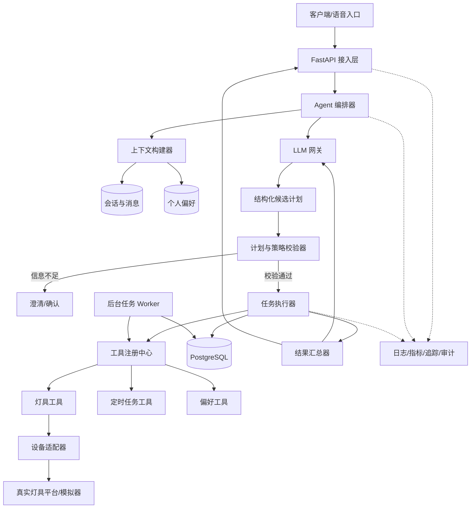
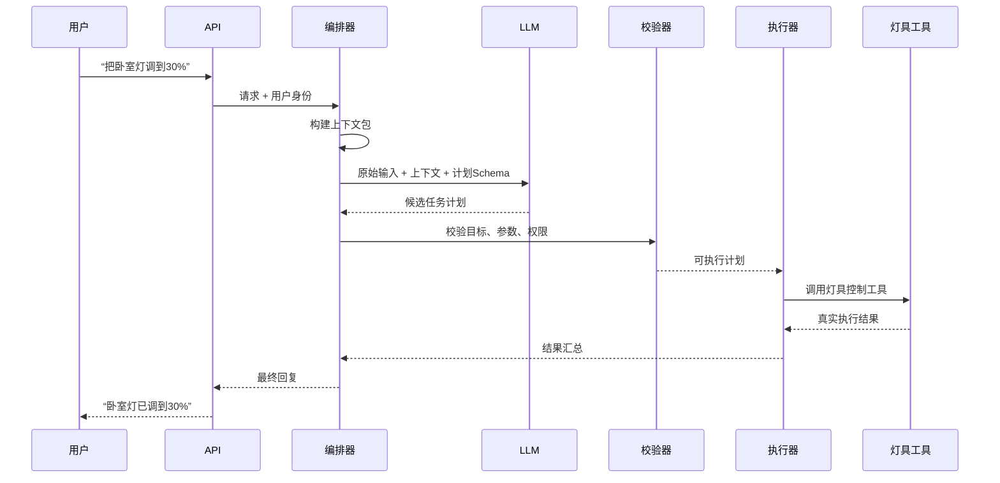
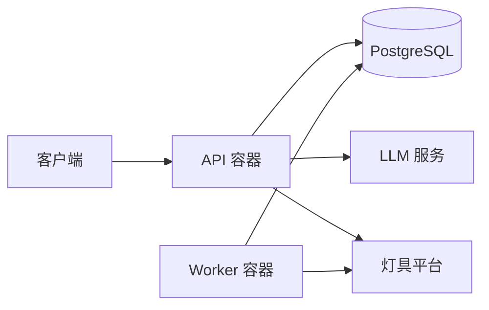

# 灯具控制与多指令 Agent 技术架构设计

> 文档类型：技术架构设计稿
> 更新日期：2026-10-17
> 关联文档：[灯具控制与多指令 Agent 功能设计](./灯具控制与多指令Agent架构设计.md)

## 1. 文档目标

本文说明灯具控制 Agent 项目如何从零落地，包括：

- 系统采用什么总体架构；
- LLM、业务程序、工具和设备平台如何协作；
- 多指令如何规划、校验和执行；
- 会话记忆与个人偏好如何保存和使用；
- 项目如何组织代码、数据、接口、任务和测试；
- 首版如何部署，以及后续在什么条件下扩展。

本文不重复定义产品功能，功能范围以关联的功能设计文档为准。

## 2. 核心架构决策

### 2.1 总体形态

首版采用：

> **模块化单体 + 结构化 LLM 规划 + 确定性工作流执行 + 工具适配层**

具体含义：

- 所有业务代码放在一个仓库中；
- API 服务和后台任务 Worker 使用同一套业务模块；
- LLM 负责理解自然语言并生成结构化候选计划；
- 程序负责校验、权限、确认、任务依赖和真实执行；
- 所有外部设备操作必须经过受控工具；
- PostgreSQL 保存业务数据、会话状态、偏好和任务记录；
- 首版不拆微服务，不使用多个自治 Agent。

### 2.2 为什么选择这种架构

| 目标 | 设计选择 |
|---|---|
| 理解灵活的自然语言 | 使用 LLM 统一识别意图、参数和多指令关系 |
| 防止模型直接控制设备 | LLM 只产生候选计划，程序校验后才调用工具 |
| 支持顺序、并行和条件任务 | 使用确定性的任务图和节点状态机 |
| 支持连续对话 | 统一构建会话上下文包 |
| 支持个人偏好 | 独立偏好存储，并由用户显式管理 |
| 降低首版复杂度 | 单仓库、单数据库，不引入消息队列和微服务 |
| 保留后续扩展能力 | 设备、模型和工具均使用内部接口隔离 |

### 2.3 首版明确不采用的方案

- 不采用多个 Agent 自由讨论后决定设备操作；
- 不采用开放式 ReAct 循环反复尝试工具；
- 不用正则表达式先解析自然语言意图；
- 不把设备实时状态放进长期记忆；
- 不为了未来规模提前拆微服务；
- 不引入向量数据库保存少量结构化个人偏好；
- 不在首版同时接入多种灯具协议。

## 3. 技术选型

### 3.1 推荐技术栈

| 层次 | 推荐方案 | 用途 |
|---|---|---|
| 开发语言 | Python | Agent、业务编排和设备工具开发 |
| Web API | FastAPI | 对话、偏好、任务查询及管理接口 |
| 数据模型 | Pydantic | LLM 输出、API 参数和工具参数校验 |
| 数据访问 | SQLAlchemy + Alembic | 数据库访问和结构迁移 |
| 数据库 | PostgreSQL | 会话、消息、偏好、任务、审计和结构化计划 |
| LLM 接入 | 模型供应商 SDK | 结构化输出、文本生成和模型调用 |
| 后台任务 | 独立 Worker + PostgreSQL 任务表 | 延迟任务、定时任务和失败恢复 |
| 测试 | pytest | 单元、集成、契约和端到端测试 |
| 可观测性 | 结构化日志 + OpenTelemetry | 请求追踪、耗时和错误定位 |
| 部署 | Docker Compose | 本地、测试和首版单机部署 |

所有依赖在项目启动时固定具体版本，并通过自动化测试后再升级，不在设计文档中锁死未来版本号。

### 3.2 为什么首版不使用 LangGraph

当前工作流只有有限的节点类型：理解、校验、确认、执行、汇总。使用普通 Python 状态机和任务依赖即可覆盖，代码更少，也更容易测试。

当出现以下情况时，再评估 LangGraph 或持久化工作流平台：

- 工作流节点类型明显增加；
- 一个任务需要跨小时或跨天暂停并恢复；
- 出现人工审批、多 Agent 协作或复杂回退；
- 自定义状态机已经难以观察和维护。

### 3.3 为什么首版不使用 Redis

首版可以直接使用 PostgreSQL 保存会话、任务和幂等记录。只有出现以下情况时再增加 Redis：

- 多实例部署后需要分布式锁；
- 会话读取量导致数据库压力明显升高；
- 需要高频发布订阅或短期缓存；
- 实测表明 Redis 能解决已出现的性能问题。

## 4. 总体系统架构



## 5. 核心请求流程

### 5.1 普通灯具控制



### 5.2 多指令请求

用户输入：

> “打开客厅灯，同时关闭书房灯，然后把卧室灯调到 30%。”

处理过程：

1. LLM 一次性生成完整候选计划，而不是边执行边猜测下一步；
2. 校验器解析真实设备，并检查所有节点；
3. 执行器识别客厅和书房节点可并行；
4. 卧室节点按用户表达的依赖关系等待；
5. 每个节点分别记录成功、失败或跳过；
6. 结果汇总器生成全部成功或部分成功回复。

### 5.3 保存个人偏好

用户输入：

> “记住，以后卧室灯默认调到 30%。”

处理过程：

1. LLM 识别为“设置偏好”，而不是立即控制灯具；
2. 校验器检查偏好类型、作用范围和用户身份；
3. 偏好工具保存 `卧室 + 默认亮度 + 30%`；
4. 系统返回已保存内容，并提供查看或删除方式；
5. 后续用户说“打开卧室灯”且未指定亮度时，才使用该偏好补全参数；
6. 如果用户明确指定 70%，当前指令覆盖 30% 的历史偏好。

### 5.4 延迟任务

用户输入：

> “十分钟后关闭床头灯。”

处理过程：

1. LLM 生成延迟任务候选计划；
2. 程序把相对时间转换为带时区的绝对执行时间；
3. 任务工具将任务写入 PostgreSQL；
4. Worker 到期领取任务并再次检查设备与用户权限；
5. Worker 调用灯具工具并记录结果；
6. 用户可以通过任务编号查询或取消。

## 6. 模块职责

### 6.1 API 接入层

职责：

- 接收文本请求；
- 验证登录身份和家庭范围；
- 创建 `request_id`、`session_id` 和 `trace_id`；
- 返回普通响应或流式响应；
- 提供偏好和定时任务管理接口。

不负责：

- 直接调用 LLM；
- 理解用户意图；
- 直接访问灯具协议。

### 6.2 Agent 编排器

Agent 编排器是一次用户请求的总协调者。

职责：

- 获取上下文包；
- 调用 LLM 生成候选计划；
- 调用校验器；
- 根据结果进入澄清、确认、执行或闲聊路径；
- 将执行事实交给结果汇总器；
- 保存本轮必要状态。

编排器不包含具体灯具协议逻辑，也不自行修改个人偏好。

### 6.3 上下文构建器

上下文构建器生成统一的 `ContextPackage`，避免不同模块各自拼接历史消息。

```text
ContextPackage
├── request_context       # 用户、家庭、会话、时区
├── current_input         # 当前原始输入
├── recent_turns          # 最近完整问答
├── pending_action        # 待澄清或待确认计划
├── relevant_preferences  # 与当前设备/房间相关的偏好
├── recent_targets        # 最近操作对象，用于代词解析
└── device_catalog        # 可见设备及能力摘要
```

规则：

- 使用统一字符或 Token 预算，建议从 6000 字符开始配置；
- 最近问答按完整轮次加入，不能截断半个问答；
- 只加载与当前家庭和用户有关的偏好；
- 不把全部历史设备状态放入上下文；
- 待确认计划优先级高于普通历史对话；
- 用户关闭偏好功能时，不加载长期个人偏好。

### 6.4 LLM 网关

所有模型调用只能经过 LLM 网关。

职责：

- 统一模型、提示模板和结构化输出配置；
- 设置超时、有限重试和并发上限；
- 记录模型、提示模板和 Schema 版本；
- 区分规划调用与回复生成调用；
- 处理拒绝、超时、截断和无效结构化输出。

并发容量只在真正调用模型时获取和释放。API、编排器、业务服务和任务节点不得重复占用同一份模型调用容量。

### 6.5 计划与策略校验器

校验器是 LLM 与真实操作之间的强制边界。

依次检查：

1. 输出结构是否符合 Schema；
2. 任务类型是否在白名单中；
3. 房间和设备是否真实存在；
4. 用户是否有权操作；
5. 设备是否支持目标能力；
6. 参数是否在合法范围；
7. 多个任务是否冲突或形成循环依赖；
8. 是否需要澄清或用户确认；
9. 延迟时间和时区是否有效；
10. 偏好写入是否得到明确授权。

校验失败时不调用任何具有副作用的工具。

### 6.6 任务执行器

执行器只接收已经校验的计划。

节点状态：

```text
PENDING → READY → RUNNING → SUCCEEDED
                          ↘ FAILED
                          ↘ TIMED_OUT
                          ↘ CANCELLED
                          ↘ SKIPPED
```

执行规则：

- 没有依赖且设备不冲突的节点可以并行；
- 操作同一设备的节点默认串行；
- 前置节点失败时，依赖它的节点按计划标记为跳过；
- 无关分支继续执行；
- 每个有副作用的节点必须携带幂等键；
- 只有临时网络错误允许有限重试；
- 执行器不重新解释用户原始语言。

### 6.7 工具注册中心

工具注册中心保存 Agent 可以使用的工具白名单。首版工具如下：

| 工具 | 用途 | 是否有副作用 |
|---|---|---|
| `light.resolve` | 将房间名或灯名解析为真实设备 | 否 |
| `light.get_state` | 查询实时开关、亮度和在线状态 | 否 |
| `light.set_state` | 设置开关、亮度、色温或颜色 | 是 |
| `task.create` | 创建延迟或定时任务 | 是 |
| `task.get` | 查询任务状态 | 否 |
| `task.cancel` | 取消未执行任务 | 是 |
| `preference.list` | 查看个人偏好 | 否 |
| `preference.set` | 新增或修改明确偏好 | 是 |
| `preference.delete` | 删除偏好 | 是 |

每个工具都必须声明：

- 输入和输出类型；
- 调用权限；
- 是否有副作用；
- 超时时间；
- 是否允许重试；
- 幂等规则；
- 可返回的业务错误码。

### 6.8 灯具领域服务

灯具领域服务维护统一业务概念：

- 家庭、房间、灯具和灯组；
- 电源、亮度、色温、颜色和场景；
- 设备在线状态；
- 属性范围和设备能力；
- 设备别名和可见范围。

上层只使用统一灯具模型，不直接处理厂商字段。

### 6.9 设备适配器

设备适配器负责把统一灯具命令转换为实际平台命令。

```text
DeviceAdapter
├── list_devices(home_id)
├── get_state(device_id)
├── set_state(device_id, desired_state, idempotency_key)
└── subscribe_events(callback)
```

首版实施顺序：

1. 实现 `MockDeviceAdapter`，用于开发和自动化测试；
2. 根据真实灯具环境选择一种协议或平台；
3. 只实现一个真实适配器；
4. 通过相同的适配器契约测试；
5. 有真实需求后再增加第二种协议。

## 7. LLM 规划设计

### 7.1 采用单次结构化规划

一次用户请求首先调用一次规划模型，要求输出固定结构。规划阶段不调用真实设备，不执行副作用工具。

推荐输出结构：

```json
{
  "intent": "device_command",
  "needs_clarification": false,
  "clarification_question": null,
  "tasks": [
    {
      "task_id": "t1",
      "type": "light.set_state",
      "target": {
        "room_name": "卧室",
        "device_name": null
      },
      "arguments": {
        "brightness_pct": 30
      },
      "depends_on": [],
      "condition": null
    }
  ],
  "preference_change": null
}
```

该结构是候选计划，不能直接执行。

### 7.2 为什么不用开放式工具循环

开放式循环让模型在每一步结果后自行决定下一个工具，适合探索型任务，但不适合首版灯具控制：

- 多指令的完整范围不容易在执行前审核；
- 更难保证同一设备的冲突顺序；
- 模型可能产生不必要的重复调用；
- 用户确认的计划可能与实际调用序列不一致；
- 测试和审计成本更高。

因此首版采用“先形成完整计划，再由程序执行”。只有确实需要根据外部未知结果重新推理时，才允许受限的第二次模型规划。

### 7.3 模型调用分类

| 调用类型 | 输入 | 输出 | 是否可调用工具 |
|---|---|---|---|
| 计划调用 | 用户输入 + ContextPackage | 结构化候选计划 | 否 |
| 澄清回复 | 缺失项和候选对象 | 一条明确问题 | 否 |
| 闲聊调用 | 用户输入 + 有限历史 | 普通文本 | 否 |
| 结果表达 | 已执行事实 + 用户输入 | 自然语言回复 | 否 |

真实工具调用始终发生在应用程序中，不发生在模型服务内部。

### 7.4 提示模板职责

规划提示模板必须明确：

- 只输出 Schema 允许的字段；
- 不虚构设备 ID；
- 不假设设备在线或操作成功；
- 区分一次操作与保存偏好；
- 识别顺序、并行、条件和延迟；
- 信息不足时标记澄清，而不是猜测；
- 不输出任何设备凭据或底层协议命令。

### 7.5 Structured Output 与原生 Function Calling 的选择

首版优先使用 Structured Output 生成完整 `TaskPlan`，不把 `light.set_state` 等真实副作用工具直接暴露给模型。

如果所选模型 SDK 通过 Function Calling 提供更稳定的严格参数约束，可以只向模型暴露一个无副作用的 `submit_candidate_plan` 函数。它的参数就是完整 `TaskPlan`，函数返回只表示“候选计划已收到”，不代表设备已经执行。

真实灯具工具仍由应用程序在校验后调用。这样可以使用模型平台的结构化能力，同时不改变“模型规划、程序批准、工具执行”的安全边界。

## 8. 工具调用设计

### 8.1 工具调用链

```text
LLM 候选任务
  → Pydantic 结构校验
  → 业务与权限校验
  → 工具名称映射
  → 工具参数构造
  → 执行器调用工具
  → 工具返回规范结果
  → 写入执行记录
  → 生成回复
```

### 8.2 工具结果格式

所有工具返回统一结果：

```json
{
  "ok": true,
  "status": "verified",
  "data": {},
  "error": null,
  "started_at": "2026-10-17T20:00:00+08:00",
  "finished_at": "2026-10-17T20:00:01+08:00"
}
```

控制类工具需要区分：

- `accepted`：平台已接受命令；
- `applied`：设备报告已应用；
- `verified`：回读状态与目标一致。

只有工具返回相应事实后，回复中才能使用“已完成”。

### 8.3 幂等与重复请求

每个副作用节点生成稳定的幂等键：

```text
hash(plan_id + task_id + target_device_id + normalized_arguments)
```

同一幂等键重复到达时，工具返回原执行结果，不再次产生副作用。

## 9. 记忆与个人偏好架构

### 9.1 信息分类

| 类别 | 存储位置 | 生命周期 | 说明 |
|---|---|---|---|
| 最近对话 | `messages` | 按会话保留策略 | 用于连续对话 |
| 待确认计划 | `plans` | 确认、取消或过期 | 用户确认时复用原计划 |
| 最近操作对象 | `session_state` | 当前会话 | 用于“它”“再亮一点” |
| 个人偏好 | `preferences` | 用户删除或关闭 | 显式长期信息 |
| 执行记录 | `executions` | 按审计策略 | 证明真实结果 |
| 设备实时状态 | 不作为记忆保存 | 实时查询 | 以设备工具结果为准 |

### 9.2 个人偏好模型

```text
Preference
├── preference_id
├── user_id
├── home_id
├── scope_type       # user / room / device / scene
├── scope_id
├── preference_key   # default_brightness 等
├── value
├── source           # explicit_chat / settings / confirmed_suggestion
├── enabled
├── created_at
└── updated_at
```

写入条件：

- 用户明确说“记住”“以后默认”；
- 用户在设置页面主动保存；
- 系统提出建议且用户明确确认。

禁止行为：

- 从一次控制操作自动推断长期偏好；
- 根据偏好主动控制设备；
- 不同用户之间共享个人偏好；
- 用户关闭偏好后继续注入模型上下文。

### 9.3 偏好优先级

```text
当前明确指令
  > 当前会话临时要求
  > 已启用的个人偏好
  > 家庭共享场景
  > 系统默认值
```

使用偏好补全参数时，系统应在执行记录中标明参数来源，便于回答“为什么设置成 30%”。

### 9.4 记忆控制

提供以下用户控制：

- 个人偏好总开关；
- 查看已保存偏好；
- 修改单项偏好；
- 删除单项或全部偏好；
- 当前请求不使用个人偏好；
- 当前会话不继续记住上下文。

下层控制只能减少记忆使用范围，不能绕过用户已经关闭的上层开关。

## 10. 数据架构

### 10.1 核心数据表

| 数据表 | 关键内容 |
|---|---|
| `users` | 用户身份、状态和时区 |
| `homes` | 家庭空间 |
| `home_members` | 用户与家庭的角色和权限 |
| `rooms` | 房间信息 |
| `devices` | 设备、能力、平台标识和在线摘要 |
| `device_aliases` | 用户或家庭定义的设备别名 |
| `sessions` | 会话和会话状态 |
| `messages` | 用户与 Agent 消息 |
| `preferences` | 用户长期偏好及来源 |
| `plans` | 原始候选计划、校验结果和计划哈希 |
| `plan_tasks` | 任务节点、依赖、参数和状态 |
| `tool_executions` | 工具调用、结果、耗时和幂等键 |
| `scheduled_tasks` | 延迟任务、执行时间和取消状态 |
| `audit_events` | 权限、确认和重要操作审计 |

### 10.2 结构化字段与 JSONB 的边界

以下内容使用普通列：

- 用户、家庭、设备和任务主键；
- 状态、时间、权限和幂等键；
- 经常用于筛选、排序或唯一约束的字段。

以下内容可以使用 JSONB：

- LLM 原始结构化计划；
- 不同设备的能力描述；
- 工具请求和响应快照；
- 不同偏好类型的值。

不能把整个数据库设计成一个无约束 JSON 文档。关键业务状态必须使用可约束、可索引的普通列。

### 10.3 数据一致性

- 计划确认时保存 `plan_hash`；
- 确认后的计划如发生变化，必须重新确认；
- 任务领取使用数据库锁，防止多个 Worker 重复执行；
- 工具执行结果先落库，再生成最终成功回复；
- 偏好更新和审计事件放在同一事务中；
- 删除偏好后立即停止后续上下文注入。

## 11. API 设计

### 11.1 对话接口

```text
POST /v1/chat
```

输入：

- `session_id`；
- `message`；
- `use_preferences`；
- 客户端请求 ID。

输出：

- Agent 回复；
- 请求状态；
- 是否需要澄清或确认；
- 计划和任务摘要；
- 可选的进度事件。

### 11.2 确认接口

```text
POST /v1/plans/{plan_id}/confirm
POST /v1/plans/{plan_id}/cancel
```

确认时必须提交计划版本或哈希，避免确认后执行另一份计划。

### 11.3 偏好接口

```text
GET    /v1/preferences
PUT    /v1/preferences/{preference_id}
DELETE /v1/preferences/{preference_id}
DELETE /v1/preferences
PUT    /v1/preferences/settings
```

### 11.4 任务接口

```text
GET    /v1/tasks
GET    /v1/tasks/{task_id}
DELETE /v1/tasks/{task_id}
```

### 11.5 设备接口

设备管理接口只面向已授权的客户端：

```text
GET /v1/devices
GET /v1/devices/{device_id}/state
```

普通客户端不直接调用底层设备适配器。

## 12. 后台任务设计

首版使用 PostgreSQL 任务表和独立 Worker，不额外引入消息队列。

Worker 循环：

1. 领取已到执行时间且状态为 `pending` 的任务；
2. 使用数据库行锁避免重复领取；
3. 将状态更新为 `running`；
4. 重新检查任务是否取消、用户是否仍有权限；
5. 调用工具；
6. 写入成功或失败结果；
7. 对临时错误按次数和退避规则重试；
8. 服务重启后继续领取未完成任务。

当任务量、重试复杂度或跨服务工作流明显增长时，再迁移到专用消息队列或持久化工作流平台。

## 13. 安全与隐私

### 13.1 身份与权限

- 所有请求从认证信息获取 `user_id`，不相信 LLM 输出的用户标识；
- 所有设备查询必须限制在当前家庭范围；
- 家庭成员角色决定查询、控制和管理权限；
- Worker 执行延迟任务前重新检查权限；
- 跨家庭设备 ID 即使真实存在也必须拒绝。

### 13.2 LLM 安全边界

- 不向模型提供设备密钥和平台凭据；
- 模型只能输出允许的候选任务类型；
- 设备名、工具返回值和历史消息都按不可信数据处理；
- 模型输出必须经过类型和业务校验；
- 模型超时或拒绝时不执行任何副作用工具；
- 调试日志不记录完整密钥和敏感个人信息。

### 13.3 个人偏好隐私

- 保存前记录来源和用户授权；
- 用户可以导出、修改、删除或关闭偏好；
- 个人偏好按用户隔离；
- 家庭共享场景需要独立权限；
- 删除后不得继续出现在新的上下文包中；
- 对话文本不因为开启偏好功能而默认全部成为长期记忆。

## 14. 可靠性设计

### 14.1 超时和重试

| 操作 | 建议处理 |
|---|---|
| LLM 超时 | 有限重试一次，仍失败则提示稍后再试 |
| 设备查询超时 | 有限重试，结果标记为未知 |
| 设备控制超时 | 使用相同幂等键重试，不能重复生成命令 |
| 权限或参数错误 | 不重试 |
| Worker 异常退出 | 任务租约到期后重新领取 |

具体超时值通过配置设置，并根据真实设备和模型延迟测量后调整。

### 14.2 部分成功

多个独立设备任务不要求全局事务。一个设备失败时：

- 已成功的独立任务保持成功；
- 依赖失败任务的节点标记为跳过；
- 无关节点继续执行；
- 最终回复逐项说明结果；
- 默认不自动回滚已经成功的灯具操作。

### 14.3 降级策略

- LLM 不可用：App 中的固定按钮控制仍可直接走业务校验和工具；
- 偏好服务异常：不使用偏好，要求用户给出明确参数；
- 状态查询失败：返回状态未知，不使用旧记忆替代；
- 回复生成失败：使用固定模板返回执行事实；
- 数据库不可用：拒绝新的设备控制，避免无法记录和审计。

## 15. 可观测性

### 15.1 统一追踪字段

每次请求贯穿以下字段：

- `trace_id`；
- `request_id`；
- `session_id`；
- `plan_id`；
- `task_id`；
- `tool_execution_id`。

### 15.2 核心指标

- LLM 规划成功率和结构校验失败率；
- 平均任务数和多指令比例；
- 澄清率及用户纠正率；
- 工具调用成功率、超时率和重试率；
- 全部成功、部分成功和全部失败比例；
- 规划、校验、设备调用和总请求的 P50/P95 延迟；
- 偏好命中率、修改率和关闭率；
- 定时任务延迟和重复执行次数。

### 15.3 审计要求

以下操作必须写审计记录：

- 权限拒绝；
- 全屋或批量控制；
- 用户确认或取消；
- 创建和取消定时任务；
- 新增、修改和删除个人偏好；
- 工具调用被安全规则拦截。

## 16. 测试架构

### 16.1 测试分层

| 层次 | 测试内容 |
|---|---|
| 单元测试 | 参数范围、偏好优先级、任务依赖、冲突和权限 |
| Schema 测试 | LLM 计划、工具输入和工具输出结构 |
| 模型评测 | 意图、实体、多指令、条件、指代和偏好写入识别 |
| 工具契约测试 | Mock 与真实设备适配器行为一致 |
| 集成测试 | API、数据库、执行器、Worker 和模拟灯具 |
| 故障测试 | 超时、离线、重复请求、服务重启和部分失败 |
| 端到端测试 | 用户输入到真实结果反馈的完整链路 |

### 16.2 必测用例

1. LLM 输出不存在的任务类型，校验器拒绝；
2. LLM 输出亮度 150%，不调用工具；
3. 同一个请求重复提交，只执行一次；
4. 两个独立设备一个成功一个失败，返回部分成功；
5. 同一设备冲突任务要求澄清；
6. 用户说“再亮一点”，正确使用会话对象；
7. 用户一次设置 30%，不写入长期偏好；
8. 用户明确说“记住”，写入偏好并可删除；
9. 当前指令覆盖历史偏好；
10. 用户关闭偏好后，模型上下文中不再包含偏好；
11. 定时任务在 Worker 重启后仍能执行；
12. 设备工具仅返回 `accepted` 时，不回复“已验证成功”。

### 16.3 模型评测数据

建立独立的中文样本集，每条样本包含：

- 用户输入；
- 必要会话上下文；
- 预期意图；
- 预期任务数量；
- 目标、参数和依赖关系；
- 是否需要澄清；
- 是否涉及偏好变更；
- 不允许发生的工具调用。

模型或提示模板升级前必须回放该数据集。

## 17. 项目目录设计

```text
lighting-agent/
├── app/
│   ├── main.py                 # FastAPI 入口
│   ├── api/                    # HTTP 接口
│   ├── agent/
│   │   ├── orchestrator.py     # 请求编排
│   │   ├── context.py          # ContextPackage
│   │   ├── planner.py          # LLM 结构化规划
│   │   ├── validator.py        # 计划与策略校验
│   │   └── responder.py        # 回复生成
│   ├── workflow/
│   │   ├── models.py           # 计划与节点状态
│   │   └── executor.py         # 顺序/并行执行
│   ├── tools/
│   │   ├── registry.py
│   │   ├── lighting.py
│   │   ├── preferences.py
│   │   └── tasks.py
│   ├── domain/
│   │   ├── lighting.py
│   │   ├── preferences.py
│   │   └── policies.py
│   ├── adapters/
│   │   ├── base.py
│   │   ├── mock.py
│   │   └── actual_platform.py
│   ├── memory/
│   │   ├── context_store.py
│   │   └── preference_store.py
│   ├── db/
│   │   ├── models.py
│   │   ├── repositories.py
│   │   └── migrations/
│   ├── worker/
│   │   └── scheduler.py
│   └── observability/
│       ├── logging.py
│       └── tracing.py
├── prompts/
│   ├── planner.md
│   └── responder.md
├── tests/
│   ├── unit/
│   ├── integration/
│   ├── contract/
│   ├── e2e/
│   └── evals/
├── docker-compose.yml
├── pyproject.toml
├── .env.example
└── README.md
```

模块只能通过公开接口依赖下一层，不能让 API 或提示模板直接访问设备适配器。

## 18. 配置与凭据

配置分为三类：

### 18.1 普通配置

- 模型名称；
- 超时和重试次数；
- 上下文预算；
- 任务执行并发度；
- 偏好功能默认开关；
- 审计和消息保留时间。

### 18.2 敏感配置

- LLM API Key；
- 数据库密码；
- 灯具平台凭据；
- 签名密钥。

敏感配置只能从环境变量或密钥管理系统读取，不写入 Git、提示模板或日志。

### 18.3 版本化配置

- 计划 Schema 版本；
- 工具 Schema 版本；
- 提示模板版本；
- 设备能力模型版本。

执行记录需要保存这些版本，保证问题可以复现。

## 19. 部署架构

### 19.1 首版部署



首版包含：

- 一个 API 容器；
- 一个 Worker 容器；
- 一个 PostgreSQL 实例；
- 一个外部 LLM 服务；
- 一个模拟或真实设备平台。

API 与 Worker 来自同一代码仓库和镜像，通过不同启动命令运行。

### 19.2 扩展条件

仅在出现实际问题后扩展：

| 现象 | 对应演进 |
|---|---|
| API 单实例吞吐不足 | 增加 API 实例和负载均衡 |
| Worker 任务积压 | 增加 Worker 并发或实例 |
| 数据库会话读取压力高 | 增加 Redis 缓存 |
| 定时和重试逻辑难以维护 | 引入专用任务队列或工作流平台 |
| 多种设备平台互相影响 | 独立拆分设备网关 |
| 多个业务领域独立演进 | 再考虑领域服务或专用 Agent |

## 20. 开发实施顺序

### 阶段一：设备模拟与基础骨架

- 建立 FastAPI、PostgreSQL、迁移和测试框架；
- 实现统一灯具领域模型；
- 实现 Mock 设备适配器；
- 完成查询和控制工具；
- 不接 LLM，先用固定计划验证完整执行链。

完成标准：通过 API 可以稳定控制模拟灯具，并获得真实状态回执。

### 阶段二：LLM 结构化规划

- 定义 `TaskPlan` Pydantic Schema；
- 编写规划提示模板；
- 接入结构化输出；
- 实现计划校验器；
- 建立基础中文评测集。

完成标准：模型只能生成允许的候选计划，无效计划不会调用工具。

### 阶段三：多指令工作流

- 实现任务节点状态机；
- 支持顺序、并行、条件和部分失败；
- 增加幂等键和执行记录；
- 支持澄清和确认。

完成标准：多指令执行结果与功能设计一致，可逐节点追踪。

### 阶段四：记忆与个人偏好

- 实现 ContextPackage；
- 保存最近对话、最近目标和待确认计划；
- 实现偏好查询、写入、删除和关闭；
- 实现参数优先级与用户隔离；
- 增加偏好相关评测。

完成标准：连续对话正确，偏好仅在授权后保存，当前指令始终优先。

### 阶段五：后台任务与真实设备

- 实现 PostgreSQL 任务表和 Worker；
- 支持延迟、查询和取消；
- 接入一个真实设备适配器；
- 完成适配器契约测试；
- 验证重启恢复和重复请求。

完成标准：定时任务不因进程重启丢失，模拟器与真实适配器遵循同一行为。

### 阶段六：生产化

- 加入身份认证、权限和审计；
- 完成结构化日志、指标和追踪；
- 加入限流、超时和告警；
- 完成故障注入与隐私检查；
- 使用回放评测控制模型升级风险。

完成标准：关键功能可监控、可审计、可恢复，并通过端到端验收。

## 21. 首版交付清单

- API 和 Worker 可独立启动；
- 数据库迁移脚本可重复执行；
- Mock 设备适配器和一个真实适配器；
- 结构化计划 Schema 与提示模板；
- 计划校验器和任务执行器；
- 灯具、任务和偏好工具；
- 会话上下文与个人偏好管理；
- 延迟任务和取消能力；
- 单元、集成、契约、端到端和模型评测；
- Docker Compose、本地配置示例和启动说明；
- 日志、审计和基础指标。

## 22. 技术验收标准

| 编号 | 验收项 | 通过标准 |
|---|---|---|
| T-01 | LLM 结构化输出 | 所有候选计划通过同一 Schema 解析 |
| T-02 | 工具安全边界 | 未校验计划无法调用副作用工具 |
| T-03 | 设备真实性 | 不存在或无权限设备不能被控制 |
| T-04 | 多指令执行 | 顺序、并行、条件和失败传播符合计划 |
| T-05 | 幂等 | 重复请求不产生重复副作用 |
| T-06 | 真实反馈 | 最终回复与工具执行记录一致 |
| T-07 | 会话记忆 | 代词和连续指令在明确时正确关联 |
| T-08 | 偏好授权 | 未明确授权的操作不写入长期偏好 |
| T-09 | 偏好优先级 | 当前指令覆盖会话和长期偏好 |
| T-10 | 偏好删除 | 删除或关闭后不再注入上下文 |
| T-11 | 定时恢复 | Worker 重启后任务不丢失且不重复执行 |
| T-12 | 故障隔离 | 一个设备失败不阻止无关设备任务 |
| T-13 | 可追踪性 | 请求、计划、任务和工具调用可关联查询 |
| T-14 | 模型升级 | 提示或模型变更前通过固定评测集 |

## 23. 官方资料依据

- OpenAI Structured Outputs：<https://developers.openai.com/api/docs/guides/structured-outputs?api-mode=responses>
- OpenAI Function Calling：<https://developers.openai.com/api/docs/guides/function-calling>
- FastAPI 异步处理：<https://fastapi.tiangolo.com/async/>
- Pydantic JSON Schema：<https://pydantic.dev/docs/validation/latest/concepts/json_schema/>
- SQLAlchemy AsyncIO：<https://docs.sqlalchemy.org/en/20/orm/extensions/asyncio.html>
- PostgreSQL JSON 类型：<https://www.postgresql.org/docs/current/datatype-json.html>

## 24. 总结

本项目首版不需要复杂的多 Agent 或微服务架构。最合适的实现是：

1. 使用 LLM 将自然语言一次性转换成结构化候选计划；
2. 使用程序校验设备、参数、权限、确认和偏好写入；
3. 使用确定性执行器处理多指令依赖并调用受控工具；
4. 使用设备适配器隔离具体灯具平台；
5. 使用 PostgreSQL 统一保存会话、个人偏好、任务和审计记录；
6. 使用 API 与 Worker 两个进程完成实时请求和延迟任务；
7. 通过 Mock 设备、契约测试和模型评测保证系统可验证。

这套架构覆盖当前全部功能需求，同时保持足够简单。只有在真实负载、工作流复杂度或设备平台数量增长后，才增加 Redis、消息队列、工作流平台、微服务或多 Agent。
