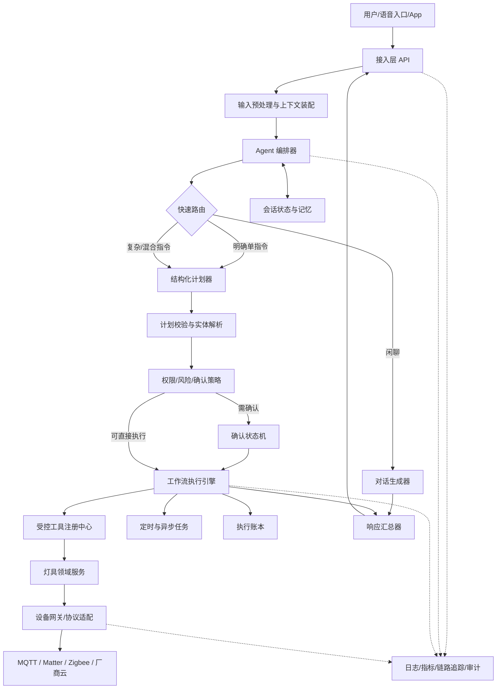
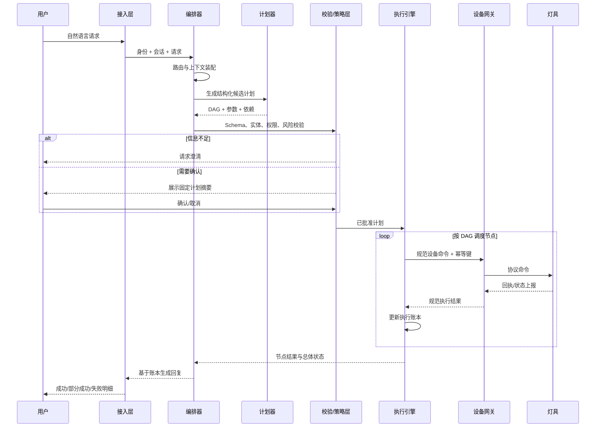

# 灯具控制、闲聊与多指令执行 Agent 架构设计

> 文档状态：设计稿
> 适用阶段：MVP 至生产化演进
> 更新日期：2026-10-17

## 1. 文档目的

本文设计一个同时支持以下能力的智能 Agent：

1. **灯具控制**：开关、亮度、色温、颜色、场景、分组控制、状态查询。
2. **日常闲聊**：常识问答、陪伴式对话、与设备无关的自然语言交流。
3. **多指令执行**：从一句话中识别多个任务，处理顺序、并行、依赖、条件、失败和部分成功。

设计目标不是让大模型直接操作设备，而是让大模型负责“理解用户和生成表达”，让确定性系统负责“校验、授权、执行和记录”。

---

## 2. 需求边界

### 2.1 功能需求

| 编号 | 能力 | 示例 |
|---|---|---|
| F-01 | 单灯控制 | “打开书桌灯” |
| F-02 | 灯组控制 | “关闭客厅所有灯” |
| F-03 | 属性调节 | “把卧室灯调到 40%，色温设为 3000K” |
| F-04 | 状态查询 | “厨房灯现在开着吗？” |
| F-05 | 场景执行 | “切换到观影模式” |
| F-06 | 闲聊 | “今天有点累，陪我聊聊” |
| F-07 | 混合多指令 | “打开客厅灯，再把卧室灯调暗，然后讲个笑话” |
| F-08 | 并行指令 | “同时关闭一楼和二楼的灯” |
| F-09 | 条件指令 | “如果书房灯开着，就把亮度调到 30%” |
| F-10 | 延迟指令 | “十分钟后关闭床头灯” |
| F-11 | 取消与追踪 | “取消刚才的定时关灯” |

### 2.2 非功能需求

- **安全**：大模型无权绕过设备权限、参数范围和确认策略。
- **可靠**：命令具有超时、重试、幂等、失败隔离和执行回执。
- **可解释**：能够回答“执行了什么、哪些成功、哪些失败、为什么”。
- **低延迟**：简单控制无需进入复杂规划；常用命令应走快速路径。
- **可扩展**：后续可增加窗帘、空调、传感器等设备类型。
- **可观测**：每次请求都有可追踪的 `trace_id`、计划和执行记录。
- **隐私**：用户偏好、家庭成员、设备位置和对话记忆分域存储。

### 2.3 首版不建议包含的能力

- 不让 Agent 自主形成长期目标并持续修改家庭环境。
- 不允许模型生成任意 MQTT Topic、HTTP 地址或设备底层命令。
- 不根据模糊的历史记忆直接执行控制，例如不能仅凭“用户通常喜欢暗一点”就自动关灯。
- 不在没有明确产品需求时拆成多个独立自治 Agent；首版采用单编排器更容易测试和审计。

---

## 3. 核心设计原则

### 3.1 大模型理解，确定性系统执行

大模型适合处理：

- 意图识别；
- 指令拆分；
- 槽位抽取；
- 指代消解；
- 生成自然语言回复；
- 在受限节点集合中生成候选执行计划。

确定性代码必须处理：

- 用户身份、家庭和设备权限；
- 设备名称到真实 `device_id` 的绑定；
- 能力检查和参数范围校验；
- 确认策略；
- 计划依赖、执行、超时、重试、幂等和补偿；
- 设备真实状态读取与结果汇总。

### 3.2 计划与执行分离

模型输出的是结构化的“候选计划”，不是已经获准的设备命令。候选计划必须依次经过：

`Schema 校验 → 实体解析 → 能力校验 → 权限校验 → 风险评估 → 用户确认（如需要）→ 执行`

### 3.3 设备状态以设备平台为准

设备状态缓存只能提升性能，不能长期充当事实来源。每条状态应至少包含：

- `value`：当前值；
- `observed_at`：观测时间；
- `source`：设备上报、主动查询或缓存；
- `quality`：是否在线、是否过期、是否估计值。

### 3.4 多指令使用有向无环图（DAG）表达

多指令不应只保存为一个字符串列表。DAG 可以表达：

- “同时”对应并行节点；
- “然后”对应依赖边；
- “如果”对应条件节点；
- “十分钟后”对应等待或调度节点；
- 某一步失败后，其依赖节点跳过，但无关分支可继续。

### 3.5 一次请求只产生一份执行账本

同一个 `request_id` 下的解析结果、确认记录、执行步骤和最终回执统一记录，避免模型回复成功但设备实际上失败。

---

## 4. 推荐总体架构

推荐采用 **模块化单体 + 工作流编排 + 工具调用（Tool Calling）** 作为首版架构。业务稳定、规模扩大后，再将设备网关、任务调度和对话服务拆成独立服务。



### 4.1 为什么不建议首版采用多 Agent

“灯具控制 Agent、闲聊 Agent、多指令 Agent”看似适合拆成三个 Agent，但独立自治 Agent 会引入路由争议、上下文重复、调用成本和结果合并问题。首版可将它们实现为同一编排器下的三个受控能力模块：

| 模块 | 职责 | 是否可直接控制设备 |
|---|---|---|
| 对话模块 | 闲聊和语言表达 | 否 |
| 计划模块 | 拆分任务并生成结构化 DAG | 否 |
| 灯具领域模块 | 解析设备能力并形成规范命令 | 否，仍需经过策略和执行引擎 |

当后续出现明显的独立领域、不同模型需求或不同团队边界时，再演进为 Supervisor + Specialist Agents 架构。

---

## 5. 模块设计

### 5.1 接入层

负责文字、语音、App 按钮等入口的统一接入。

主要职责：

- 身份认证和家庭空间识别；
- 生成 `request_id`、`session_id`、`trace_id`；
- 语音转文字及基础规范化；
- 限流、敏感输入过滤和请求大小限制；
- 将流式响应、确认卡片和执行进度返回给客户端。

### 5.2 上下文装配器

向模型提供最小且必要的上下文，建议统一为 `ContextPackage`：

```json
{
  "request_id": "req_20261017_001",
  "user": {"user_id": "u_01", "home_id": "h_01", "role": "owner"},
  "session": {"session_id": "s_01", "recent_turns": []},
  "device_scope": {
    "rooms": ["客厅", "卧室", "书房"],
    "aliases": {"阅读灯": "device_light_07"}
  },
  "pending_action": null,
  "locale": "zh-CN",
  "timezone": "Asia/Shanghai"
}
```

上下文应有明确的字符或 Token 预算。优先保留当前请求、待确认计划、最近完整问答和必要设备摘要；不要把完整设备历史和全部聊天记录都塞给模型。

### 5.3 快速路由器

先判断请求属于哪类：

- `CHAT`：纯闲聊；
- `DEVICE_QUERY`：查询设备状态；
- `DEVICE_COMMAND`：单个明确控制；
- `MULTI_COMMAND`：多个控制或存在顺序、并行、条件；
- `MIXED`：设备操作和闲聊混合；
- `CLARIFY`：缺少关键参数；
- `CANCEL_OR_STATUS`：取消任务或查询进度。

对于“打开客厅灯”这类高置信度、单设备、无歧义请求，可以走小模型或规则快速路径；复杂请求再交给完整计划器。

### 5.4 结构化计划器

计划器只能从允许的节点类型和工具白名单中选择，输出必须符合 JSON Schema。

推荐节点类型：

- `DEVICE_COMMAND`：设备控制；
- `DEVICE_QUERY`：设备查询；
- `CHAT_RESPONSE`：闲聊生成；
- `CONDITION`：条件判断；
- `WAIT`：短时等待；
- `SCHEDULE`：持久化定时任务；
- `CLARIFICATION`：向用户补充询问。

候选计划示例：

```json
{
  "plan_id": "plan_001",
  "summary": "调节客厅灯、关闭书房灯并讲一个笑话",
  "nodes": [
    {
      "id": "n1",
      "type": "DEVICE_COMMAND",
      "action": "light.set",
      "target": {"room": "客厅", "device_type": "light"},
      "arguments": {"power": "on", "brightness_pct": 50, "color_temperature_k": 3000},
      "depends_on": []
    },
    {
      "id": "n2",
      "type": "DEVICE_COMMAND",
      "action": "light.set",
      "target": {"room": "书房", "device_type": "light"},
      "arguments": {"power": "off"},
      "depends_on": []
    },
    {
      "id": "n3",
      "type": "CHAT_RESPONSE",
      "action": "chat.tell_joke",
      "arguments": {"language": "zh-CN"},
      "depends_on": ["n1", "n2"]
    }
  ]
}
```

计划器输出中的房间名仍然是语义实体，必须由实体解析器映射到用户家庭内的真实设备，不能由模型虚构 `device_id`。

### 5.5 实体解析与灯具领域模型

实体解析器处理以下歧义：

- 同一房间存在多盏灯；
- “主灯”“阅读灯”等别名；
- “这里”“那盏灯”“刚才的灯”等指代；
- 灯具是否支持亮度、色温或 RGB；
- 百分比、色温和颜色的单位与范围。

建议建立统一能力模型：

```json
{
  "device_id": "light_1024",
  "home_id": "h_01",
  "room_id": "room_living",
  "display_name": "客厅主灯",
  "online": true,
  "capabilities": {
    "power": true,
    "brightness_pct": {"min": 1, "max": 100},
    "color_temperature_k": {"min": 2700, "max": 6500},
    "rgb": false
  }
}
```

若用户说“把客厅灯调成红色”，但目标灯不支持 RGB，系统应明确说明能力限制，不能假装成功。

### 5.6 策略与安全层

策略层在任何设备调用前执行，至少包含：

1. **身份与权限**：用户是否属于家庭、是否可控制目标房间和设备。
2. **参数合法性**：亮度 0–100、色温处于设备支持范围。
3. **在线状态**：离线设备是立即失败、排队等待还是提示用户。
4. **风险分级**：普通照明操作通常为低风险；大范围、定时、循环或异常高频操作可升级风险。
5. **确认策略**：仅在确有风险、存在歧义或影响范围大时确认，避免每次开灯都打断用户。
6. **速率限制**：防止模型循环调用或用户误触导致频繁闪烁。
7. **提示注入防护**：设备名称、第三方返回值和历史文本都作为数据处理，不得改变系统策略。

建议风险规则：

| 等级 | 示例 | 默认处理 |
|---|---|---|
| L0 | 查询状态、纯闲聊 | 直接执行 |
| L1 | 单灯开关、亮度调整 | 直接执行并回执 |
| L2 | 全屋关灯、长延时任务、重复场景 | 简要确认或根据用户策略执行 |
| L3 | 异常高频闪烁、跨家庭控制、权限冲突 | 拒绝并记录审计日志 |

### 5.7 工作流执行引擎

执行引擎接收已经批准的 DAG，维护每个节点的状态：

`PENDING → READY → RUNNING → SUCCEEDED / FAILED / TIMED_OUT / SKIPPED / CANCELLED`

关键机制：

- 依赖全部成功后节点才进入 `READY`；
- 无依赖节点可受控并行执行；
- 同一设备的冲突命令按序串行；
- 每个写操作携带幂等键；
- 网络错误可有限重试，业务拒绝不盲目重试；
- 定时任务持久化，服务重启后仍可恢复；
- 用户取消时停止未开始的节点，并尽力取消可中断节点；
- 执行结果写入账本后，响应汇总器再生成最终回复。

#### 冲突处理

对同一设备出现相互冲突的指令时，按以下规则处理：

1. 若用户明确给出顺序，如“打开再关闭”，按顺序执行；
2. 若同一时刻既要求打开又关闭，要求用户澄清；
3. 若先设置亮度再关灯，可保留亮度配置后关闭；
4. 不依赖模型自由猜测设备最终状态。

### 5.8 工具注册中心

工具层必须是白名单 API，而不是让模型访问任意函数。

建议首版工具：

```text
light.resolve_targets(query, home_id)
light.get_state(device_ids)
light.set_state(device_ids, desired_state, idempotency_key)
light.activate_scene(scene_id, idempotency_key)
task.schedule(execute_at, approved_plan)
task.cancel(task_id)
task.get_status(task_id)
```

每个工具应定义：

- 输入/输出 Schema；
- 调用权限；
- 超时时间；
- 是否允许重试；
- 幂等规则；
- 错误码；
- 审计字段；
- 可执行的设备范围。

### 5.9 设备网关与协议适配器

领域服务不关心底层是 Matter、MQTT、Zigbee、Home Assistant 还是厂商云。设备网关负责：

- 将规范命令转换成协议命令；
- 订阅设备状态上报；
- 维护设备在线状态和能力目录；
- 统一厂商错误码；
- 处理弱网、断连和命令回执。

建议区分三个结果：

- `ACCEPTED`：网关已接受，尚未证明设备状态变化；
- `APPLIED`：设备或平台确认已应用；
- `VERIFIED`：回读状态与目标状态一致。

用户界面不能把 `ACCEPTED` 直接显示为“已经成功”。

### 5.10 对话与记忆

建议分为四类状态：

| 状态 | 内容 | 生命周期 |
|---|---|---|
| 当前轮状态 | 当前文本、解析结果、候选计划 | 单次请求 |
| 会话状态 | 最近对话、代词指向、待确认计划 | 当前会话 |
| 用户偏好 | 常用房间名、确认偏好、语言 | 长期且可管理 |
| 执行账本 | 命令、节点状态、回执、错误 | 按审计策略保留 |

注意：

- 设备当前状态不能只存入对话记忆；
- 未完成、取消或失败的回复不应被摘要为“已执行成功”；
- 待确认计划必须保存原始 `plan_id` 和计划摘要，用户说“确认”时不能重新让模型生成另一份计划；
- 用户可以关闭长期记忆；关闭后不得继续以历史偏好扩展控制范围。

### 5.11 响应汇总器

响应必须依据真实执行账本生成。推荐格式：

- 全部成功：“已把客厅灯调到 50% 和 3000K，并关闭书房灯。再送你一个笑话……”
- 部分成功：“客厅灯已调好；书房灯离线，未能关闭。笑话仍可以继续为你讲。”
- 全部失败：“两盏灯都未执行：客厅灯无权限，书房灯离线。”
- 已排程：“已创建任务，将于 22:30 关闭床头灯。任务编号为 T-102。”

避免使用无法从执行记录证明的“应该已经”“大概完成了”等表述。

---

## 6. 完整执行流程



按步骤说明：

1. **接收请求**：认证用户，确定家庭、会话和时区。
2. **装配上下文**：加入最近完整对话、待确认计划和必要设备目录摘要。
3. **路由**：区分闲聊、查询、单指令、多指令、混合请求或取消请求。
4. **生成计划**：模型通过结构化输出生成候选 DAG。
5. **确定性校验**：验证 Schema，解析实体，检查设备能力、参数、权限和冲突。
6. **澄清或确认**：缺少关键目标时澄清；高风险或大范围操作展示固定计划等待确认。
7. **执行调度**：执行引擎根据依赖关系串行或并行调用工具。
8. **状态验证**：区分网关接受、设备应用和状态回读验证。
9. **失败处理**：重试可重试错误，跳过依赖失败节点，不影响无关分支。
10. **结果汇总**：从执行账本生成自然语言回执。
11. **状态持久化**：保存任务和审计记录；仅按用户设置保存允许的对话偏好。

---

## 7. 典型场景

### 7.1 单指令快速路径

用户：“打开客厅主灯。”

流程：

1. 规则或小模型识别为 `DEVICE_COMMAND`；
2. 实体解析器唯一匹配客厅主灯；
3. 权限和在线状态通过；
4. 调用 `light.set_state`；
5. 收到设备回执后回复结果。

### 7.2 并行多指令

用户：“同时关闭客厅灯和书房灯。”

生成两个无依赖节点，在并发上限内同时执行。一个失败不应回滚另一个成功的关灯操作，最终返回部分成功结果。

### 7.3 顺序多指令

用户：“先打开床头灯，调到 20%，五分钟后关闭。”

推荐计划：

```text
n1 打开并调节床头灯
 └─成功后→ n2 创建五分钟后的持久化关灯任务
```

若 `n1` 失败，默认不创建 `n2`；若产品希望即使当前离线也保留关灯任务，应将其设计为显式策略。

### 7.4 条件指令

用户：“如果书房灯还开着，就把它调到 30%。”

执行引擎先实时查询书房灯：

- 若为开：执行亮度调整；
- 若为关：跳过调整，并告诉用户条件不满足；
- 若状态未知：说明无法判断，不把未知当作关闭或开启。

### 7.5 混合请求

用户：“关闭客厅灯，然后陪我聊会儿。”

设备节点执行后，无论成功或失败都可以进入闲聊节点；回复开头先交代控制结果，再开始对话。是否依赖成功应由计划中的边类型表达，而不是写死所有节点“前一步失败就停止”。

### 7.6 歧义澄清

用户：“把灯打开。”

如果当前房间和最近指代都不能唯一定位设备，应询问：“你想打开哪个房间或哪一盏灯？”不能默认打开全屋灯。

---

## 8. 数据结构建议

### 8.1 执行计划

```text
ExecutionPlan
├── plan_id
├── request_id
├── version
├── user_id / home_id
├── status
├── risk_level
├── confirmation_status
├── nodes[]
├── edges[]
├── created_at / expires_at
└── plan_hash
```

`plan_hash` 用于保证用户确认的就是实际执行的计划。确认后如目标、参数或节点发生变化，必须重新校验，必要时重新确认。

### 8.2 执行节点

```text
ExecutionNode
├── node_id
├── type
├── action
├── resolved_targets[]
├── arguments
├── depends_on[]
├── failure_policy
├── timeout_ms
├── retry_policy
├── idempotency_key
├── status
├── started_at / finished_at
└── result / error
```

### 8.3 错误分类

| 错误类别 | 示例 | 是否重试 |
|---|---|---|
| `VALIDATION_ERROR` | 亮度为 150% | 否 |
| `AMBIGUOUS_TARGET` | “打开灯”匹配多盏 | 否，先澄清 |
| `PERMISSION_DENIED` | 儿童账号控制受限房间 | 否 |
| `DEVICE_OFFLINE` | 灯具离线 | 依据策略 |
| `GATEWAY_TIMEOUT` | 网关超时 | 有限重试 |
| `PROTOCOL_REJECTED` | 厂商平台拒绝命令 | 通常否 |
| `STATE_MISMATCH` | 回读状态与目标不一致 | 可重试或提示 |
| `PLAN_EXPIRED` | 用户确认过晚 | 否，重新规划 |

---

## 9. 技术选型建议

以下为参考组合，不是强制依赖：

| 层次 | MVP 建议 | 规模化选择 |
|---|---|---|
| API | Python + FastAPI | API Gateway + 独立服务 |
| Agent 编排 | 自定义状态机或 LangGraph | 持久化工作流平台 |
| 数据校验 | Pydantic / JSON Schema | 统一 Schema Registry |
| 设备消息 | MQTT 或现有家庭平台 API | MQTT 集群 / Matter Bridge |
| 缓存与短期状态 | Redis | Redis Cluster |
| 业务与审计数据 | PostgreSQL | PostgreSQL + 分区/归档 |
| 异步任务 | Celery/RQ/轻量调度器 | Temporal 等持久化工作流引擎 |
| 可观测性 | 结构化日志 + OpenTelemetry | 指标、日志、追踪统一平台 |

首版建议保持一个可部署服务，但在代码中按以下模块分层：

```text
app/
├── api/                 # 接入与响应协议
├── agent/               # 路由、上下文、计划器、回复生成
├── domain/lighting/     # 灯具实体、能力和业务规则
├── policy/              # 权限、风险、确认和限流
├── workflow/            # DAG、状态机、执行账本
├── tools/               # 工具定义与注册
├── gateway/             # Matter/MQTT/Zigbee/厂商适配器
├── memory/              # 会话和用户偏好
├── storage/             # Redis/PostgreSQL 访问
└── observability/       # 日志、指标、追踪和审计
```

---

## 10. 可靠性与安全细节

### 10.1 幂等

每个控制节点生成稳定的幂等键，例如：

```text
idempotency_key = hash(plan_id + node_id + target_id + normalized_arguments)
```

重试时复用同一个键，避免网络超时后重复执行场景或闪烁命令。

### 10.2 超时与重试

- 只对网络超时、临时网关不可用等瞬时错误重试；
- 使用指数退避和随机抖动；
- 设置单节点超时和整份计划总时限；
- 不对权限拒绝、非法参数和不支持能力重试。

### 10.3 补偿与回滚

灯具控制不一定适合自动回滚。例如客厅灯成功关闭、书房灯失败时，再把客厅灯打开可能违背用户意图。因此默认采用：

- 报告部分成功；
- 只对明确需要原子性的“场景切换”配置补偿策略；
- 执行前保存必要的旧状态，但只有产品规则允许时才回滚。

### 10.4 防止模型越权

- 模型只看到业务工具名，不接触设备凭据；
- 工具入参经过强类型校验；
- `home_id`、`user_id` 从认证上下文注入，不能接受模型传入值覆盖；
- 数据库查询始终限定家庭和权限范围；
- 模型输出中的设备 ID 仍需二次校验；
- 第三方设备返回文本不得拼接为高优先级指令。

---

## 11. 可观测性与审计

每次请求至少记录：

- `trace_id`、`request_id`、`session_id`、`plan_id`；
- 路由分类及置信度；
- 模型版本、提示模板版本、Schema 版本；
- 计划节点及其依赖；
- 策略判定、确认人和确认时间；
- 工具调用耗时、重试次数和规范错误码；
- 设备最终回执；
- 总延迟和最终状态。

日志应对用户文本、家庭地址、设备凭据和长期记忆做脱敏。审计日志与普通调试日志应分开设置权限和保留周期。

关键指标：

- 意图路由准确率；
- 设备实体解析成功率；
- 无需澄清完成率；
- 指令成功率、部分成功率、超时率；
- 从请求到设备接受/验证的 P50、P95 延迟；
- 计划 Schema 失败率；
- 越权拦截和重复命令拦截次数；
- 用户纠正率，例如“不是这个灯”。

---

## 12. 测试与验收

### 12.1 测试分层

1. **单元测试**：参数边界、能力校验、权限规则、DAG 调度、冲突检测。
2. **契约测试**：工具 Schema、网关适配器、错误码映射。
3. **模型离线评测**：意图、实体、顺序词、并行词、条件词和指代数据集。
4. **仿真集成测试**：使用虚拟灯具模拟在线、离线、延迟和状态不一致。
5. **故障注入**：网络超时、重复回执、服务重启、Redis/数据库短暂不可用。
6. **安全测试**：越权家庭、恶意设备名、提示注入、超高频命令。
7. **端到端验收**：验证回复内容与真实执行账本一致。

### 12.2 核心验收用例

| 编号 | 输入/条件 | 预期结果 |
|---|---|---|
| A-01 | “打开客厅灯”且唯一匹配 | 成功控制并给出回执 |
| A-02 | “打开灯”且存在多个房间 | 询问澄清，不执行 |
| A-03 | “同时关闭客厅和书房灯” | 两节点并行，分别记录结果 |
| A-04 | 一个灯成功、一个离线 | 返回部分成功，不虚报全部成功 |
| A-05 | “先开灯，十分钟后关闭” | 创建持久化任务，重启后仍存在 |
| A-06 | 重放同一个请求 | 幂等，不重复产生副作用 |
| A-07 | 无权限控制另一家庭设备 | 拒绝，且无设备调用 |
| A-08 | 亮度 150% | 校验失败，不下发命令 |
| A-09 | 灯不支持 RGB | 明确说明能力不支持 |
| A-10 | 用户确认后计划被篡改 | `plan_hash` 不一致，拒绝执行 |
| A-11 | “关灯然后讲笑话”且灯离线 | 报告失败后仍可继续闲聊 |
| A-12 | 模型生成不存在的工具 | Schema/白名单拦截 |
| A-13 | 网关只返回已接受 | 回复“命令已发送/待确认”，不宣称已验证成功 |
| A-14 | 用户取消定时任务 | 状态变为 `CANCELLED`，到时不执行 |

---

## 13. 分阶段落地计划

### 阶段一：单指令 MVP

- 支持开关、亮度、色温和状态查询；
- 建立设备能力模型、工具白名单和执行账本；
- 完成身份、权限、Schema 校验、超时和真实回执；
- 闲聊与控制明确路由。

退出标准：单指令端到端稳定，回复与设备结果一致。

### 阶段二：多指令与混合请求

- 引入 DAG 和节点状态机；
- 支持串行、并行、条件、部分成功和混合闲聊；
- 增加固定计划确认、`plan_hash` 和幂等键；
- 建立模型离线评测集。

退出标准：多指令失败不会导致错误的全局成功回复，依赖和无关分支行为符合设计。

### 阶段三：定时任务与生产可靠性

- 引入持久化调度；
- 支持取消、恢复、重试和服务重启恢复；
- 完善审计、告警、链路追踪和故障注入测试；
- 建立用户可管理的长期偏好与隐私开关。

退出标准：定时任务不会因服务重启丢失，所有操作可追踪和审计。

### 阶段四：规模化演进

- 根据负载拆分设备网关、任务服务和对话服务；
- 增加更多智能家居领域；
- 只有在出现明确隔离收益时，演进为 Supervisor + Specialist Agents；
- 通过灰度、回放评测和在线指标验证每次模型或提示模板升级。

---

## 14. 关键决策总结

1. 首版采用**单一编排器下的模块化能力**，不使用多个自由自治 Agent。
2. 大模型只生成结构化候选计划，所有设备操作必须经过确定性校验与策略层。
3. 多指令使用 DAG 表达顺序、并行、条件和失败传播。
4. 设备控制必须通过受控工具注册中心和协议无关的设备网关。
5. 最终回复以执行账本和设备回执为依据，不以模型推测为依据。
6. 会话记忆、用户偏好、设备状态和执行审计分开存储。
7. 首版优先做正确性、安全性和可观测性，再考虑多 Agent 和服务拆分。

这套架构既能覆盖“开灯”“陪我聊天”这样的简单请求，也能稳定处理“先调灯、再等待、条件判断、并行执行、最后闲聊”的复杂组合，同时保留从 MVP 向生产级智能家居 Agent 演进的空间。
