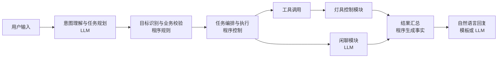
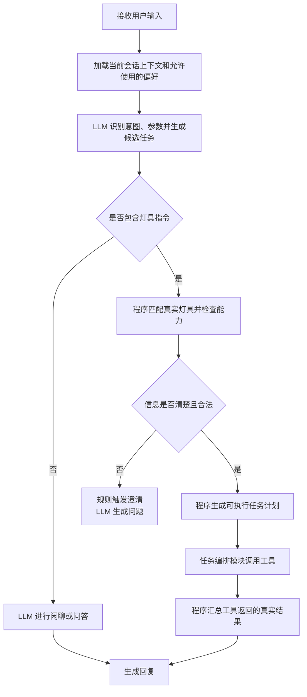

# 灯具控制与多指令 Agent 功能设计

> 文档类型：功能设计稿
> 更新日期：2026-10-17

## 1. 产品目标

设计一个家庭灯具 Agent，使用户可以通过自然语言完成灯具控制、状态查询、连续操作和日常闲聊。

Agent 应当做到：

- 用户可以像与人交流一样控制灯具；
- 能听懂一句话中的多个要求；
- 能区分灯具指令和普通聊天；
- 指令不清楚时主动询问，而不是随意执行；
- 执行后明确告知成功、失败或部分成功。

## 2. 功能范围

### 2.1 灯具控制

支持以下基础操作：

- 打开或关闭灯具；
- 调节亮度；
- 调节色温；
- 调节灯光颜色；
- 控制单盏灯、某个房间的灯或全部灯具；
- 切换预设场景，例如阅读模式、观影模式、睡眠模式；
- 延迟或定时执行，例如“十分钟后关灯”。

示例：

- “打开客厅灯。”
- “把卧室灯调到 30%。”
- “将书房灯调成暖光。”
- “关闭家里所有灯。”
- “切换到观影模式。”

### 2.2 灯具状态查询

用户可以查询：

- 灯是否开启；
- 当前亮度、色温或颜色；
- 哪些灯处于开启状态；
- 某个定时任务是否仍然有效；
- 某条指令是否已经执行。

示例：

- “客厅灯现在开着吗？”
- “还有哪些灯没有关？”
- “刚才设置的十分钟后关灯还有效吗？”

### 2.3 日常闲聊

Agent 可以处理与灯具无关的普通交流，例如：

- 日常问候；
- 简单知识问答；
- 情绪陪伴；
- 讲故事、笑话或提供生活建议。

闲聊功能与灯具控制相互独立。用户只想聊天时，Agent 不应触发任何设备操作。

### 2.4 多指令执行

Agent 可以识别一句话中的多个任务，并按照用户表达的关系执行。

#### 顺序执行

用户使用“先……再……”“然后”等表达时，按照指定顺序执行。

示例：

> “先打开客厅灯，再把亮度调到 50%。”

#### 同时执行

用户使用“同时”“一起”等表达时，可以同时处理多个互不冲突的任务。

示例：

> “同时关闭客厅灯和书房灯。”

#### 条件执行

用户使用“如果……就……”时，先判断条件是否满足，再决定是否执行后续操作。

示例：

> “如果书房灯还开着，就把亮度调到 30%。”

#### 延迟执行

用户可以要求一段时间后执行某个任务。

示例：

> “打开床头灯，十分钟后关闭。”

#### 混合任务

一句话可以同时包含设备操作和闲聊任务。

示例：

> “把客厅灯调暗一点，然后给我讲个笑话。”

Agent 应先说明灯具操作结果，再继续完成聊天任务。

### 2.5 终端交互形态

终端定位为：

> 一个以星火形象为核心、以语音交互为主、以聊天记录和任务状态为辅助的轻量智能终端。

终端提供两种展示模式：

#### 星火模式

星火模式是默认模式，通过助手形象和动画表达当前状态：

- 空闲时保持低干扰的呼吸或闪烁效果；
- 聆听时显示正在接收语音；
- 思考时显示正在处理请求；
- 播报时显示正在回答；
- 执行设备任务时显示执行中、成功或失败；
- 需要用户确认时显示明确的确认提示。

#### 聊天记录模式

用户可以通过触摸、滑动或语音命令切换到聊天记录模式。该模式展示当前会话中的：

- 用户语句和助手回复；
- 多指令执行进度；
- 需要确认的操作；
- 设备执行结果和失败原因。

默认情况下，终端以星火模式为主；用户主动查看记录或执行复杂任务时进入聊天记录模式，长时间无操作后可以回到星火模式。显示屏只展示 Agent 输出的结构化状态，不负责意图识别或设备控制。

当前验证阶段不要求专用硬件。使用电脑浏览器模拟终端界面，使用带麦克风的耳机完成语音输入和输出；星火动画、聊天记录和任务进度均先在网页中验证。ESP32 或其他带屏终端属于后续客户端形态，不改变上述功能边界。

## 3. 功能架构

Agent 在功能上分为六个部分。LLM 负责理解和表达，规则程序负责判断和校验，任务执行模块负责实际操作。

### 3.1 对话理解

由 **LLM 负责**，判断用户是在：

- 控制灯具；
- 查询状态；
- 进行闲聊；
- 下达多个指令；
- 确认、取消或修改之前的任务。

### 3.2 灯具控制

由 **LLM 提取语义，程序完成最终确认**。需要识别：

- 控制哪个房间；
- 控制哪一盏灯；
- 打开、关闭还是调节；
- 亮度、颜色或色温是多少。

例如，LLM 可以理解“把这里调暗一点”是在调节当前房间灯光；程序需要进一步确认“这里”对应哪个房间、目标灯具是否存在，以及它是否支持亮度调节。

### 3.3 多指令处理

由 **LLM 负责语义拆分和关系识别**，将复杂表达拆成多个候选任务，并判断任务之间是：

- 按顺序执行；
- 同时执行；
- 满足条件后执行；
- 延迟执行；
- 某一步失败后是否继续其他任务。

LLM 只负责说明“用户希望完成哪些任务，以及任务之间是什么关系”，不直接执行这些任务。程序需要检查任务是否完整、是否冲突，并按照确认后的关系执行。

### 3.4 闲聊服务

由 **LLM 负责**，回答与设备无关的问题，并在混合请求中与灯具任务自然衔接。闲聊模块不能主动调用灯具控制功能。

### 3.5 任务编排与执行

由 **确定性的程序逻辑负责**，包括：

- 按照顺序或并行关系组织任务；
- 判断前一步失败后是否继续；
- 等待用户确认或补充信息；
- 调用灯具控制功能；
- 记录每一项任务的执行结果。

LLM 不负责判断一条设备指令是否已经真实执行成功。

### 3.6 结果反馈

由 **程序先汇总真实结果，模板或 LLM 再组织语言**，向用户说明：

- 哪些任务执行成功；
- 哪些任务执行失败；
- 失败的原因；
- 是否需要用户补充信息；
- 是否已创建延迟或定时任务。

LLM 只能基于程序提供的结果生成回复，不能自行补充不存在的成功状态。

## 4. 功能职责边界

### 4.1 各模块负责什么

| 功能环节 | 主要负责人 | 具体职责 | 明确边界 |
|---|---|---|---|
| 意图识别 | LLM | 判断是控制、查询、闲聊、取消还是混合请求 | 不直接调用设备 |
| 指令拆分 | LLM | 将一句话拆成一个或多个候选任务 | 不决定任务是否合法 |
| 指令关系规划 | LLM | 理解“先、再、同时、如果、十分钟后”等语义关系 | 输出的是候选计划，不是最终执行计划 |
| 设备目标确定 | 程序为主，LLM 辅助 | 根据房间、名称、上下文查找真实灯具 | LLM 不能虚构或自行选定不存在的设备 |
| 参数和能力检查 | 业务规则 | 检查亮度范围、设备能力、在线状态和操作权限 | 不由 LLM 自行判断通过 |
| 澄清判断 | 业务规则 | 判断目标不唯一、参数缺失或指令冲突 | LLM 负责把澄清问题说得自然 |
| 确认判断 | 业务规则 | 判断全屋控制、重复任务等操作是否需要确认 | LLM 不能跳过确认 |
| 顺序与并行执行 | 任务编排模块 | 根据已确认的任务关系逐项或同时执行 | 不重新解释用户意图 |
| 工具选择 | LLM 建议，程序批准 | 根据候选任务选择查询、控制、定时或取消工具 | 未通过校验时不能调用 |
| 工具调用 | 任务编排模块 | 使用已校验的参数调用工具并接收结果 | LLM 不直接连接真实设备 |
| 灯具实际控制 | 灯具控制模块 | 向具体灯具发送操作并获得结果 | 不负责闲聊和语言理解 |
| 会话记忆 | 上下文模块 | 保存最近操作对象、待确认任务和连续对话信息 | 不长期保存所有聊天内容 |
| 个人偏好 | 偏好模块 | 保存用户明确要求记住的设置 | 不能据此主动控制设备 |
| 闲聊 | LLM | 生成普通对话内容 | 不能因为聊天内容自行操作设备 |
| 结果反馈 | 程序 + LLM | 程序提供事实，LLM 或模板生成自然语言回复 | 回复不能改变真实执行结果 |

### 4.2 为什么输入直接交给 LLM

用户的原始输入直接交给 LLM 进行意图识别、参数提取和任务规划，不在 LLM 前增加正则解析。原因是用户可能用很多不同方式表达同一个需求，例如：

- “把客厅灯调暗一点。”
- “客厅太亮了。”
- “灯光柔和一些。”
- “观影的时候别这么亮。”

这些表达中的动作、程度和上下文需要一起理解。即使正则先提取出“50%”或“十分钟后”，LLM 仍然需要重新阅读完整句子，正则并没有减少模型的核心工作，反而可能产生两套不一致的解析结果。因此：

- **LLM 统一完成自然语言意图识别、参数提取和多指令规划**；
- LLM 按照固定格式输出候选任务，供后续程序校验；
- 程序规则检查模型输出中的时间、百分比、设备和操作是否合法，但不重复理解原始句子；
- 正则只可用于手机号码、时间格式等纯格式校验，不参与意图判断和任务规划；
- App 按钮等本身已经代表明确动作的输入，可以直接进入业务校验，不需要经过 LLM，也不属于自然语言正则解析。

### 4.3 指令规划的边界

指令规划分为两层：

1. **语义规划由 LLM 完成**：理解用户要做哪些事，以及这些事情是顺序、并行、条件还是延迟关系。
2. **执行规划由程序完成**：检查目标和参数，判断是否需要澄清或确认，再决定哪些任务可以执行、何时执行以及失败后如何处理。

因此，LLM 输出的是“候选任务计划”，只有经过程序校验后才成为“可执行任务计划”。

### 4.4 示例

用户说：

> “先把客厅灯调到 50%，如果书房灯还开着就关掉，然后给我讲个笑话。”

各模块的分工如下：

1. **LLM**：从完整原句中识别出调节客厅灯、查询并关闭书房灯、讲笑话三个任务，以及“50%”参数和任务关系。
2. **业务规则**：确认客厅灯和书房灯真实存在，检查亮度参数与调节能力，并判断是否存在歧义。
3. **任务编排模块**：先调节客厅灯，再查询书房灯并按条件处理，最后进入闲聊任务。
4. **灯具控制模块**：实际执行灯具操作并返回成功或失败结果。
5. **LLM 或回复模板**：根据真实结果向用户反馈，再继续讲笑话。

### 4.5 是否需要工具调用

**需要。** LLM 只能理解用户意图，无法直接读取或改变真实灯具状态。所有会产生外部操作或需要实时数据的任务都必须通过工具完成。

至少需要四类功能工具：

- 查询灯具状态；
- 控制灯具；
- 创建延迟或定时任务；
- 查询或取消尚未执行的任务。

纯闲聊不需要调用灯具工具。工具调用的边界是：

1. LLM 根据用户输入提出要调用的工具和参数；
2. 程序检查设备、参数、权限和确认状态；
3. 只有校验通过后，任务编排模块才能真正调用工具；
4. 工具返回真实结果；
5. LLM 根据工具结果组织回复，不能自行假设调用成功。

多指令场景下，LLM 先给出完整候选计划，再由任务编排模块按照顺序或并行关系调用多个工具。不能让 LLM 在没有整体计划的情况下随意连续试调用。

### 4.6 是否需要记忆机制

需要，但应将不同信息分开处理：

| 信息类型 | 是否需要 | 主要内容 | 使用边界 |
|---|---|---|---|
| 会话记忆 | 必需 | 最近控制的灯、代词指向、待澄清问题、待确认任务 | 会话结束或超时后可以清理 |
| 任务状态 | 必需 | 正在执行、延迟执行和已经取消的任务 | 用于查询、取消和结果反馈 |
| 长期个人偏好 | 必需，可由用户关闭 | 常用亮度、色温、场景和设备别名 | 用户可查看、修改和删除 |
| 设备实时状态 | 不作为记忆 | 灯的开关、亮度、在线状态 | 使用时通过工具重新查询 |
| 普通闲聊内容 | 默认不长期保存 | 一般聊天内容 | 只有用户明确同意时才保存必要信息 |

会话记忆是连续对话的基础。例如：

> 用户：“打开客厅灯。”
> 用户：“再亮一点。”

系统需要通过会话记忆知道“再亮一点”仍然指向客厅灯。但“客厅灯当前是否开启”属于实时设备状态，不能只依赖历史记忆判断，应通过状态查询工具获取。

### 4.7 为什么需要个人偏好

个人偏好是核心功能。没有个人偏好，Agent 只能机械执行完整指令，无法理解“按我平时的亮度”“打开我的阅读模式”等个性化表达。

首版必须支持记录个人偏好，但只记录用户**明确要求保存**或在设置页面主动配置的内容，不应默认从每次操作中自动推断。

可以记录：

- 用户为设备设置的别名；
- 明确指定的常用亮度、色温或颜色；
- 用户明确保存的阅读、观影、睡眠等场景；
- 用户选择的确认方式或回复风格。

不应自动记录：

- 一次性的灯具操作；
- 未经用户确认的模型推测；
- 灯具实时状态；
- 与灯具功能无关的敏感聊天内容。

例如，用户说“把卧室灯调到 30%”只代表本次操作；用户说“记住，以后卧室灯默认调到 30%”才表示需要保存个人偏好。

如果系统发现用户多次重复相同设置，可以询问“是否将其保存为默认偏好”，但必须在用户确认后才能保存。

偏好的使用优先级为：

`用户当前明确指令 > 当前会话要求 > 已保存个人偏好 > 系统默认值`

个人偏好只能用于补全用户没有说明的参数或改善回复方式，不能让 Agent 在没有指令的情况下主动控制灯具。用户还应能够查询“你记住了我什么”、修改某项偏好、删除全部偏好或关闭偏好功能。

个人偏好应绑定到具体用户。同一家庭中的不同成员可以拥有不同偏好；家庭共享的灯光场景应作为共享场景保存，不能与个人偏好混在一起。

### 4.8 最终决策原则

- 需要理解自然语言含义的工作，优先由 LLM 完成；
- 有明确标准、涉及权限或会产生实际操作的判断，由程序规则完成；
- 设备操作只能由灯具控制模块完成；
- 任何 LLM 结论都不能绕过程序校验直接控制设备；
- 不在 LLM 前增加另一套自然语言正则解析逻辑；
- 实时设备信息通过工具获取，不从记忆中猜测；
- 只在用户明确授权时保存长期个人偏好。

## 5. 核心执行流程

完整流程如下：

1. 接收用户输入，并加载当前会话上下文和用户允许使用的偏好。
2. LLM 从完整输入中识别请求类型、参数和任务关系，生成候选计划。
3. 程序查找真实灯具，检查参数、能力和任务冲突。
4. 如果信息不完整或存在歧义，由程序触发澄清，LLM 组织提问方式。
5. 校验通过后，由任务编排模块生成最终计划并调用相应工具。
6. 程序汇总工具返回的真实结果，并更新必要的会话和任务状态。
7. 模板或 LLM 根据结果生成自然语言反馈。

## 6. 多指令处理规则

### 6.1 明确顺序优先

如果用户明确表达了先后顺序，必须按照该顺序执行。

例如：

> “先关闭客厅灯，再打开卧室灯。”

不能改变为同时执行。

### 6.2 没有依赖的任务可以同时执行

例如：

> “关闭客厅灯和书房灯。”

两个任务互不依赖，可以同时执行。

### 6.3 单项失败不影响无关任务

例如用户要求同时关闭客厅灯和书房灯，书房灯离线：

- 客厅灯仍然正常关闭；
- 书房灯记录为失败；
- 最终回复为部分成功。

### 6.4 后续任务依赖前一步时，失败后停止

例如：

> “先打开客厅灯，然后把它调到 50%。”

如果灯没有成功打开，后续亮度调节应停止，并向用户说明原因。

### 6.5 冲突指令需要澄清

例如：

> “同时打开并关闭客厅灯。”

Agent 不应自行选择其中一个，而应询问用户最终希望灯保持什么状态。

## 7. 对话与上下文规则

Agent 需要理解当前对话中的简短指代。

示例：

> 用户：“打开客厅灯。”
> 用户：“再亮一点。”

第二句话中的操作对象应理解为客厅灯。

但以下情况需要重新询问：

- 距离上次灯具操作已经很久；
- 最近控制过多盏灯；
- “它”“那盏灯”等指代无法唯一确定；
- 用户切换了房间或家庭场景。

以上信息属于短期会话记忆，用于保证连续对话能够成立。长期个人偏好只有在用户明确要求“记住”时才保存，并且不能因为历史偏好而擅自执行设备操作。

## 8. 澄清与确认设计

### 8.1 需要澄清的情况

- 没有说明控制哪盏灯；
- 一个名称对应多盏灯；
- 没有说明具体参数；
- 指令之间相互冲突；
- 设备不支持用户要求的功能。

示例：

> 用户：“把灯打开。”
> Agent：“你想打开哪个房间的灯？”

### 8.2 建议确认的情况

- 控制全屋或大量灯具；
- 创建较长时间后的任务；
- 创建重复任务；
- 用户的表达可能产生较大影响。

示例：

> 用户：“以后每天凌晨两点打开全屋灯。”
> Agent：“这会每天控制全屋灯。是否确认创建该任务？”

普通的单灯开关不需要反复确认，以免影响使用体验。

## 9. 异常与反馈设计

### 9.1 全部成功

> “已打开客厅灯，并将亮度调到 50%。”

### 9.2 部分成功

> “客厅灯已关闭；书房灯当前离线，暂时无法关闭。”

### 9.3 全部失败

> “卧室灯当前无法连接，因此没有完成操作。”

### 9.4 功能不支持

> “这盏灯只支持亮度和色温调节，不支持彩色灯光。”

### 9.5 信息不足

> “你想调整哪一盏灯？还需要告诉我目标亮度。”

### 9.6 延迟任务已创建

> “好的，我会在十分钟后关闭床头灯。”

所有回复都应以真实结果为准，不能在尚未确定执行成功时直接回复“已经完成”。

## 10. 典型使用场景

### 场景一：简单控制

> 用户：“打开客厅灯。”
> Agent：“客厅灯已打开。”

### 场景二：连续对话

> 用户：“打开卧室灯。”
> Agent：“卧室灯已打开。”
> 用户：“调暗一点。”
> Agent：“已将卧室灯亮度调低。”

### 场景三：多指令

> 用户：“关闭客厅灯，把卧室灯调到 30%，然后打开书房灯。”
> Agent：“已关闭客厅灯，将卧室灯调到 30%，并打开书房灯。”

### 场景四：部分失败

> 用户：“关闭客厅灯和书房灯。”
> Agent：“客厅灯已关闭；书房灯当前离线，未能关闭。”

### 场景五：控制与闲聊混合

> 用户：“把床头灯调到 20%，再给我讲个故事。”
> Agent：“床头灯已调到 20%。接下来给你讲一个小故事……”

### 场景六：表达不清楚

> 用户：“把灯调亮。”
> Agent：“你想调亮客厅灯、卧室灯，还是其他灯？”

## 11. MVP 功能范围

首个版本建议只实现以下功能：

1. 单灯和房间灯组的开关控制；
2. 亮度和色温调节；
3. 灯具状态查询；
4. 简单闲聊；
5. 一句话内的顺序和并行指令；
6. 信息不足时的澄清；
7. 成功、失败和部分成功反馈；
8. 简单延迟关灯；
9. 取消尚未执行的延迟任务；
10. 通过工具查询和控制真实灯具；
11. 保存当前会话中的最近操作对象、待澄清问题和待确认任务；
12. 保存用户明确设置的个人偏好；
13. 支持用户查询、修改、删除或关闭个人偏好。

首版暂不包含：

- Agent 主动决定何时控制灯具；
- 复杂的长期自动化规则；
- 多个独立 Agent 之间的协作；
- 对空调、窗帘等其他设备的控制；
- 基于用户习惯的自动执行；
- 自动推断并长期保存个人偏好。

首版包含显式的个人偏好管理。根据重复行为主动建议用户保存偏好，可以作为后续增强能力。

## 12. 功能验收标准

| 编号 | 验收内容 | 预期结果 |
|---|---|---|
| F-01 | 用户指定唯一灯具 | 正确识别并执行 |
| F-02 | 用户未指定灯具 | 先询问，不直接执行 |
| F-03 | 用户一次下达多个指令 | 正确拆分，无遗漏 |
| F-04 | 用户明确先后顺序 | 严格按顺序执行 |
| F-05 | 多个任务互不依赖 | 可以同时执行 |
| F-06 | 其中一个任务失败 | 返回部分成功及失败原因 |
| F-07 | 指令中包含闲聊 | 控制与闲聊均得到处理 |
| F-08 | 设备不支持目标能力 | 明确说明不支持 |
| F-09 | 指令相互冲突 | 请求用户澄清 |
| F-10 | 用户使用“它”“再亮一点” | 在目标明确时正确继承上下文 |
| F-11 | 用户创建延迟任务 | 明确说明执行时间和任务内容 |
| F-12 | 用户取消延迟任务 | 任务不再执行并给出反馈 |
| F-13 | LLM 生成灯具候选任务 | 校验通过后才允许调用工具 |
| F-14 | 用户查询灯具当前状态 | 通过工具查询，不直接使用历史记忆 |
| F-15 | 用户只执行一次亮度调整 | 不自动保存为长期偏好 |
| F-16 | 用户明确要求记住默认亮度 | 经用户授权后保存，并允许查询和删除 |
| F-17 | 当前指令与个人偏好冲突 | 按当前明确指令执行，不修改原偏好 |
| F-18 | 不同家庭成员设置不同偏好 | 偏好按用户隔离，互不覆盖 |
| F-19 | 用户关闭个人偏好功能 | 不加载或新增个人偏好 |

## 13. 总结

该 Agent 的核心不是让多个 Agent 自由协作，而是围绕用户的一次自然语言输入完成四件事：

1. 判断用户想控制灯具还是进行闲聊；
2. 识别目标灯具和具体操作；
3. 将多个指令按照顺序、并行、条件或延迟关系组织起来；
4. 将每项任务的真实结果清楚地反馈给用户。

职责边界可以概括为：**自然语言输入直接由 LLM 负责理解和规划，规则程序负责校验和决策，任务编排模块负责执行，灯具控制模块负责实际操作，程序与 LLM 共同完成结果反馈**。正则不参与自然语言意图识别和任务规划。

首个版本应优先保证指令理解准确、歧义处理清楚、多个任务不遗漏以及结果反馈真实。具体技术架构、接口设计和部署方式可以在功能范围确定后再单独设计。
