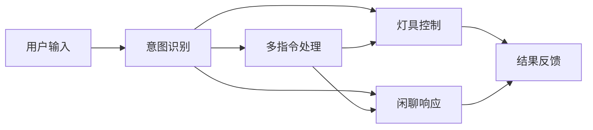
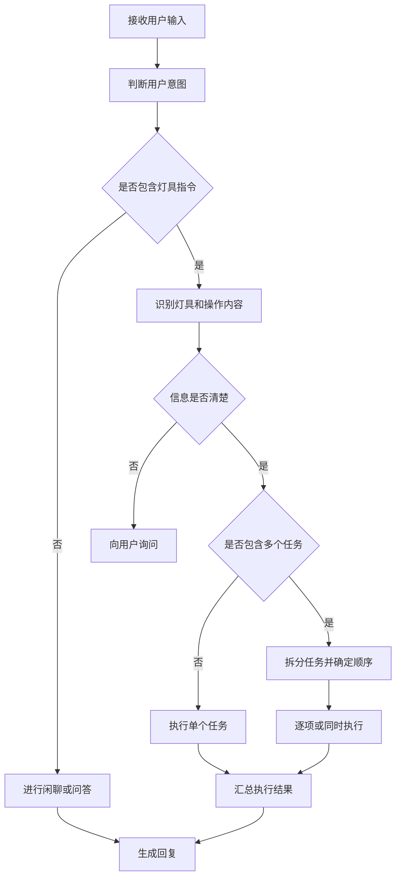

# 灯具控制与多指令 Agent 功能设计

> 文档类型：功能设计稿
> 更新日期：2026-10-17

## 1. 产品目标

设计一个家庭灯具 Agent，使用户可以通过自然语言完成灯具控制、状态查询、连续操作和日常闲聊。

Agent 应当做到：

- 用户可以像与人交流一样控制灯具；
- 能听懂一句话中的多个要求；
- 能区分灯具指令和普通聊天；
- 指令不清楚时主动询问，而不是随意执行；
- 执行后明确告知成功、失败或部分成功。

## 2. 功能范围

### 2.1 灯具控制

支持以下基础操作：

- 打开或关闭灯具；
- 调节亮度；
- 调节色温；
- 调节灯光颜色；
- 控制单盏灯、某个房间的灯或全部灯具；
- 切换预设场景，例如阅读模式、观影模式、睡眠模式；
- 延迟或定时执行，例如“十分钟后关灯”。

示例：

- “打开客厅灯。”
- “把卧室灯调到 30%。”
- “将书房灯调成暖光。”
- “关闭家里所有灯。”
- “切换到观影模式。”

### 2.2 灯具状态查询

用户可以查询：

- 灯是否开启；
- 当前亮度、色温或颜色；
- 哪些灯处于开启状态；
- 某个定时任务是否仍然有效；
- 某条指令是否已经执行。

示例：

- “客厅灯现在开着吗？”
- “还有哪些灯没有关？”
- “刚才设置的十分钟后关灯还有效吗？”

### 2.3 日常闲聊

Agent 可以处理与灯具无关的普通交流，例如：

- 日常问候；
- 简单知识问答；
- 情绪陪伴；
- 讲故事、笑话或提供生活建议。

闲聊功能与灯具控制相互独立。用户只想聊天时，Agent 不应触发任何设备操作。

### 2.4 多指令执行

Agent 可以识别一句话中的多个任务，并按照用户表达的关系执行。

#### 顺序执行

用户使用“先……再……”“然后”等表达时，按照指定顺序执行。

示例：

> “先打开客厅灯，再把亮度调到 50%。”

#### 同时执行

用户使用“同时”“一起”等表达时，可以同时处理多个互不冲突的任务。

示例：

> “同时关闭客厅灯和书房灯。”

#### 条件执行

用户使用“如果……就……”时，先判断条件是否满足，再决定是否执行后续操作。

示例：

> “如果书房灯还开着，就把亮度调到 30%。”

#### 延迟执行

用户可以要求一段时间后执行某个任务。

示例：

> “打开床头灯，十分钟后关闭。”

#### 混合任务

一句话可以同时包含设备操作和闲聊任务。

示例：

> “把客厅灯调暗一点，然后给我讲个笑话。”

Agent 应先说明灯具操作结果，再继续完成聊天任务。

## 3. 功能架构

Agent 在功能上分为五个部分：

### 3.1 对话理解

负责判断用户是在：

- 控制灯具；
- 查询状态；
- 进行闲聊；
- 下达多个指令；
- 确认、取消或修改之前的任务。

### 3.2 灯具控制

负责识别控制对象和控制内容，例如：

- 控制哪个房间；
- 控制哪一盏灯；
- 打开、关闭还是调节；
- 亮度、颜色或色温是多少。

### 3.3 多指令处理

负责把复杂表达拆成多个任务，并判断任务之间是：

- 按顺序执行；
- 同时执行；
- 满足条件后执行；
- 延迟执行；
- 某一步失败后是否继续其他任务。

### 3.4 闲聊服务

负责回答与设备无关的问题，并在混合请求中与灯具任务自然衔接。

### 3.5 结果反馈

负责向用户说明：

- 哪些任务执行成功；
- 哪些任务执行失败；
- 失败的原因；
- 是否需要用户补充信息；
- 是否已创建延迟或定时任务。

## 4. 核心执行流程

完整流程如下：

1. 接收用户输入。
2. 判断输入属于灯具控制、状态查询、闲聊还是混合任务。
3. 如果包含灯具指令，识别目标灯具和具体操作。
4. 如果信息不完整或存在歧义，先向用户询问。
5. 如果包含多个指令，将其拆分并判断执行关系。
6. 执行灯具任务和闲聊任务。
7. 汇总每项任务的结果。
8. 用自然语言向用户反馈。

## 5. 多指令处理规则

### 5.1 明确顺序优先

如果用户明确表达了先后顺序，必须按照该顺序执行。

例如：

> “先关闭客厅灯，再打开卧室灯。”

不能改变为同时执行。

### 5.2 没有依赖的任务可以同时执行

例如：

> “关闭客厅灯和书房灯。”

两个任务互不依赖，可以同时执行。

### 5.3 单项失败不影响无关任务

例如用户要求同时关闭客厅灯和书房灯，书房灯离线：

- 客厅灯仍然正常关闭；
- 书房灯记录为失败；
- 最终回复为部分成功。

### 5.4 后续任务依赖前一步时，失败后停止

例如：

> “先打开客厅灯，然后把它调到 50%。”

如果灯没有成功打开，后续亮度调节应停止，并向用户说明原因。

### 5.5 冲突指令需要澄清

例如：

> “同时打开并关闭客厅灯。”

Agent 不应自行选择其中一个，而应询问用户最终希望灯保持什么状态。

## 6. 对话与上下文规则

Agent 需要理解当前对话中的简短指代。

示例：

> 用户：“打开客厅灯。”
> 用户：“再亮一点。”

第二句话中的操作对象应理解为客厅灯。

但以下情况需要重新询问：

- 距离上次灯具操作已经很久；
- 最近控制过多盏灯；
- “它”“那盏灯”等指代无法唯一确定；
- 用户切换了房间或家庭场景。

Agent 可以记住用户明确设置的偏好，例如常用亮度或常用场景，但不能因为历史偏好而擅自执行设备操作。

## 7. 澄清与确认设计

### 7.1 需要澄清的情况

- 没有说明控制哪盏灯；
- 一个名称对应多盏灯；
- 没有说明具体参数；
- 指令之间相互冲突；
- 设备不支持用户要求的功能。

示例：

> 用户：“把灯打开。”
> Agent：“你想打开哪个房间的灯？”

### 7.2 建议确认的情况

- 控制全屋或大量灯具；
- 创建较长时间后的任务；
- 创建重复任务；
- 用户的表达可能产生较大影响。

示例：

> 用户：“以后每天凌晨两点打开全屋灯。”
> Agent：“这会每天控制全屋灯。是否确认创建该任务？”

普通的单灯开关不需要反复确认，以免影响使用体验。

## 8. 异常与反馈设计

### 8.1 全部成功

> “已打开客厅灯，并将亮度调到 50%。”

### 8.2 部分成功

> “客厅灯已关闭；书房灯当前离线，暂时无法关闭。”

### 8.3 全部失败

> “卧室灯当前无法连接，因此没有完成操作。”

### 8.4 功能不支持

> “这盏灯只支持亮度和色温调节，不支持彩色灯光。”

### 8.5 信息不足

> “你想调整哪一盏灯？还需要告诉我目标亮度。”

### 8.6 延迟任务已创建

> “好的，我会在十分钟后关闭床头灯。”

所有回复都应以真实结果为准，不能在尚未确定执行成功时直接回复“已经完成”。

## 9. 典型使用场景

### 场景一：简单控制

> 用户：“打开客厅灯。”
> Agent：“客厅灯已打开。”

### 场景二：连续对话

> 用户：“打开卧室灯。”
> Agent：“卧室灯已打开。”
> 用户：“调暗一点。”
> Agent：“已将卧室灯亮度调低。”

### 场景三：多指令

> 用户：“关闭客厅灯，把卧室灯调到 30%，然后打开书房灯。”
> Agent：“已关闭客厅灯，将卧室灯调到 30%，并打开书房灯。”

### 场景四：部分失败

> 用户：“关闭客厅灯和书房灯。”
> Agent：“客厅灯已关闭；书房灯当前离线，未能关闭。”

### 场景五：控制与闲聊混合

> 用户：“把床头灯调到 20%，再给我讲个故事。”
> Agent：“床头灯已调到 20%。接下来给你讲一个小故事……”

### 场景六：表达不清楚

> 用户：“把灯调亮。”
> Agent：“你想调亮客厅灯、卧室灯，还是其他灯？”

## 10. MVP 功能范围

首个版本建议只实现以下功能：

1. 单灯和房间灯组的开关控制；
2. 亮度和色温调节；
3. 灯具状态查询；
4. 简单闲聊；
5. 一句话内的顺序和并行指令；
6. 信息不足时的澄清；
7. 成功、失败和部分成功反馈；
8. 简单延迟关灯；
9. 取消尚未执行的延迟任务。

首版暂不包含：

- Agent 主动决定何时控制灯具；
- 复杂的长期自动化规则；
- 多个独立 Agent 之间的协作；
- 对空调、窗帘等其他设备的控制；
- 基于用户习惯的自动执行。

## 11. 功能验收标准

| 编号 | 验收内容 | 预期结果 |
|---|---|---|
| F-01 | 用户指定唯一灯具 | 正确识别并执行 |
| F-02 | 用户未指定灯具 | 先询问，不直接执行 |
| F-03 | 用户一次下达多个指令 | 正确拆分，无遗漏 |
| F-04 | 用户明确先后顺序 | 严格按顺序执行 |
| F-05 | 多个任务互不依赖 | 可以同时执行 |
| F-06 | 其中一个任务失败 | 返回部分成功及失败原因 |
| F-07 | 指令中包含闲聊 | 控制与闲聊均得到处理 |
| F-08 | 设备不支持目标能力 | 明确说明不支持 |
| F-09 | 指令相互冲突 | 请求用户澄清 |
| F-10 | 用户使用“它”“再亮一点” | 在目标明确时正确继承上下文 |
| F-11 | 用户创建延迟任务 | 明确说明执行时间和任务内容 |
| F-12 | 用户取消延迟任务 | 任务不再执行并给出反馈 |

## 12. 总结

该 Agent 的核心不是让多个 Agent 自由协作，而是围绕用户的一次自然语言输入完成四件事：

1. 判断用户想控制灯具还是进行闲聊；
2. 识别目标灯具和具体操作；
3. 将多个指令按照顺序、并行、条件或延迟关系组织起来；
4. 将每项任务的真实结果清楚地反馈给用户。

首个版本应优先保证指令理解准确、歧义处理清楚、多个任务不遗漏以及结果反馈真实。具体技术架构、接口设计和部署方式可以在功能范围确定后再单独设计。
